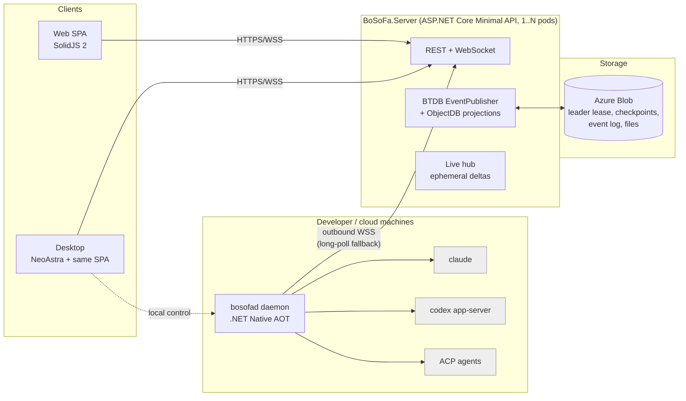

# BoSoFa: Bobris Software Factory, architecture and delivery plan

Status: draft 1 (2026-11-07). The decisions listed below are settled. The open questions are at the end.

## 1. What we are building

BoSoFa runs AI coding harnesses such as Claude Code, Codex, and ACP agents (OpenCode, Copilot CLI, …) on many machines. People control it from one place: a web UI or a desktop app.



### Settled decisions

| Area | Decision |
|---|---|
| Tenancy | One tenant with many users. User names and emails are visible to every user. |
| Server | C# / .NET 10 Minimal API (`WebApplication.CreateSlimBuilder`). AOT is not a goal, but stay AOT-friendly: the BTDB source generator, STJ source generation, no reflection in our code. Then publishing AOT later is a build switch, not a rewrite. |
| DB and event log | BTDB.Replication with EventSourcing: one process with file-system storages for development, Azure Blob storages with N pods (StatefulSet) on AKS. |
| Web UI | A pure SPA (no SSR, no SolidStart) in SolidJS 2, served as static files by the server with an `index.html` fallback. |
| Daemon | `bosofad`, C# .NET Native AOT. It talks to the server only over HTTP(S), always dialing out. |
| Daemon transport | A WebSocket over 443, falling back to HTTP long-poll plus batched POST. |
| Sign-in | Any OIDC provider. Development has a fake local login. |
| Desktop | NeoAstra (the CodeAlta UI technology) hosting the same SolidJS SPA. It is a client of the server and can also manage the local daemon. |
| Distribution | The server is the only source of both the daemon and the desktop app (decided 2026-11-09): a computer installs them from the server's install page, and every update comes from the same server. No package registry or store is involved. Since 2026-11-13 the server's build carries both for every platform, so a release is just a server build: no separate publishing, signing key, channels or rollouts ([releasing.md](releasing.md)). |
| AKS deployment | A Pulumi project in the operations repositories, like SkillShare's (decided 2026-11-09). This repository ships the image and the contract in [deploy-aks.md](deploy-aks.md), not a Helm chart. |
| White labeling | A build brand (`-p:Brand=qsf`: QSF, Quadient Software Factory, `qsfd`) names binaries, apps, folders and services; the server's configuration (`BoSoFa:Branding`) can rename the UI on top (decided 2026-11-09, [branding.md](branding.md)). |
| Hosting | Both a cluster on AKS over Azure Blob storage and a single node on its own disk with no Azure ([deploy-single-node.md](deploy-single-node.md)) (decided 2026-11-09). |
| Session visibility | Only a session's creator sees it: list, transcript, requests, live updates. To anyone else it does not exist (decided 2026-11-09). |
| Machines | Any user runs the daemon on their own computers; the approver owns the machine. Cloud machines wait until the existing features are finished (decided 2026-11-09). |
| Out of v1 | Git forge integration, an offline view of local sessions in the desktop app, code signing of downloads (decided 2026-11-09). |

## 2. Lessons taken from the reference projects

From **CodeAlta** (local copy `../CodeAlta`):
- Pin each harness CLI version with a SHA-256 per platform. Give each harness and account its own home folder (`CLAUDE_CONFIG_DIR`, `CODEX_HOME`) and never touch the user's `~/.claude` / `~/.codex`.
- Drive Claude Code with `claude -p --input-format stream-json --output-format stream-json` and its control protocol. Drive Codex with `codex app-server` (JSON-RPC over stdio). Drive the long tail of agents through ACP.
- Use a loopback MCP endpoint per session, protected by a bearer token, to give harnesses our own tools.
- Workers dial out. Use idempotency keys and per-stream cursors, so that reconnecting resumes where it stopped and never duplicates.
- Self-update with a launcher parent, versioned folders side by side, a trial period, and automatic rollback.
- Use guardrail tests to enforce project boundaries, for example that the daemon never references server assemblies.
- NeoAstra: native web view (WebView2 / WKWebView / WebKitGTK), the `app://` scheme, a typed C#↔TS RPC that generates TypeScript, and a framework-agnostic Vite frontend.
- To avoid: a fleet surface that grew enormous (signed policies, campaigns, budgets…), and docs that drifted away from the code.

From **T3 Code** (`pingdotgg/t3code`):
- Our app's IDs are primary and provider IDs are only references. The model is Thread/Session → Run (turn) → tree of nodes (tool, approval, subagent).
- A provider adapter has explicit **capability flags** (steer, fork, rollback, compact…). Never branch on the provider's name.
- Approvals and questions are durable "runtime requests". They survive restarts and can be answered from any client.
- Clients subscribe to a cheap **shell/sidebar summary**, plus the full stream only for the session they are viewing (snapshot + cursor, then deltas).
- Message dispatch modes: *steer active*, *queue after active*, *restart active* (when the provider cannot steer).
- Checkpoints are git snapshots in hidden refs (`refs/bosofa/checkpoints/...`), so diffs and rollback never commit to the user's branch.
- Terminals are attach/observe: the PTY lives on the machine, keeps a capped history, and many clients can watch.
- Recorded replay fixtures per provider make tests deterministic and free.

## 3. Repository layout

```
bosofa/
  BoSoFa.slnx
  global.json  Directory.Build.props  Directory.Packages.props   (central package versions)
  AGENTS.md / CLAUDE.md          (agent rules, including the Solid 2 rules in §7)
  src/
    BoSoFa.Protocol/             AOT-safe: daemon↔server envelopes, DTOs, STJ source-gen context. No other deps.
    BoSoFa.Harness.Abstractions/ AOT-safe: normalized harness events, capability flags.
    BoSoFa.Server/               Minimal API host: auth, REST, WebSockets, static SPA, live hub.
    BoSoFa.Server.Domain/        BTDB events, handlers (Validate/Consume), relations, queries.
    BoSoFa.Server.Storage/       Blob store abstraction (Azure Blob / file system), content addressed.
    BoSoFa.Daemon/               bosofad executable (AOT): host, CLI, service install, launcher, updater.
    BoSoFa.Daemon.Core/          Connection, outbox, sessions, files, MCP endpoint, skills sync.
    BoSoFa.Daemon.Harnesses/     Adapters: ClaudeCode, Codex (app-server), Acp; installers.
    BoSoFa.Desktop/              NeoAstra host and native RPC services (local daemon, notifications, files).
  web/                           pnpm workspace
    packages/api/                Generated TS types and client (from OpenAPI + live message schema).
    packages/client/             Connection, normalized stores, subscriptions (shared by web and desktop).
    packages/ui/                 Solid components and headless primitives, theme tokens.
    apps/web/                    SPA entry (browser platform).
    apps/desktop/                SPA entry (NeoAstra platform: adds the local-daemon features).
  tests/                         MSTest/xUnit per project; Server.MultiNode tests on Azurite; Playwright e2e.
  deploy/                        Dockerfile. The AKS workload is a Pulumi project in the operations repositories.
  docs/
```

Boundary rules, enforced by an architecture test:
- `Protocol` and `Harness.Abstractions` reference nothing of ours.
- The daemon never references `Server.*`.
- The server never references `Daemon.*` or `Harness` adapters.

## 4. Server

### 4.1 Hosting and BTDB

- The same binary runs in two modes:
  - **Single node (dev):** `AddBTDBReplicationSingleNode` + `AddBTDBEventLogSingleNode` with the `FileSystem*` storages under `./data`. No peer endpoints.
  - **Cluster (AKS):** `AddBTDBReplication` + `AddBTDBEventLog` with `AzureLeaderStorage`, `AzureReplicationStorage` and `AzureEventLogStorage`, plus `MapBTDBReplication()` / `MapBTDBEventLog()` on the one port the server listens on. Pods serve plain HTTP; a reverse proxy terminates TLS.
- Run as a StatefulSet with a headless Service (`publishNotReadyAddresses: true`) for stable peer DNS. Blob is the source of truth and `/data` is a cache (`emptyDir`, or a small PVC for warm restarts). Use workload identity for Blob.
- Domain state lives in **one `EventPublisher`** (a data topic plus a metadata topic). Handlers are `IEventHandler<TEvent[,TResult]>` with a synchronous `Validate` and a deterministic `Consume` that writes relations via `Ambient.Relation<T>()`, using `ev.When` and never the clock.
- Commands go through `PublishAndWaitAsync`, which gives read-your-writes on the pod that publishes. Any pod may publish, because the event log forwards to the topic owner, so writes never need routing to a leader.
- Leader-only background work runs in `ReplicationLeadership.RunWhileLeaderAsync`: timeouts, cleanup, cloud-machine reaping.
- BTDB prerequisites, released in **BTDB 36.2.0** (pin all `BTDB*` packages to this version in `Directory.Packages.props`):
  - `ReplicationFileSet.RestoreAsync(local, storage, genesis)` restores published history or creates an empty database (check `HasPublishedHistory`); no test-only helper is needed.
  - `EventLogOptions.Retention = topic => …` gives per-topic `EventLogRetention(MaxBytes, MaxAge)`; null means forever. Keep the `EventPublisher` data and metadata topics forever.

### 4.2 What goes where

| Data | Store | Why |
|---|---|---|
| Users, machines, projects, sessions (summary), runs, runtime requests, harness/MCP/skill catalogs, enrollments, daemon releases, audit | Domain events → ObjectDB relations | Durable, queryable, replicated |
| Session transcript **items** (user message, final assistant message, tool call + result, plan, diff summary) | Domain events → `SessionItem` relation keyed `(SessionId, Seq)` | Durable history; any pod can query a page |
| Large payloads (tool output > 16 KiB, attachments, uploaded/downloaded files, skill bundles, daemon binaries, checkpoint diffs) | Blob store, content-addressed by SHA-256; events carry only the hash | Keeps the event log small |
| Streaming deltas (tokens, command output chunks, terminal bytes) | **Ephemeral** live hub, never persisted | Volume; the final item is persisted anyway |

- Delivering **live events to clients:** `Ambient.RegisterPostCommit` runs on every pod after each batch becomes visible. It pushes to the pod-local hub, and the hub fans out to the WebSocket subscribers on that pod. Clients carry the event-ID cursor (offset + 1) and resync with *snapshot + cursor* on reconnect, because post-commit callbacks are lost on a crash.
- **Ephemeral deltas across pods:** the pod holding the daemon's connection owns that machine's live streams. Its ID is recorded in a presence relation, refreshed by heartbeat events at a low rate, or via `ReplicationPresence`. Another pod whose client watches the session opens one internal streaming HTTP request to the owner pod: `GET /internal/live/machines/{id}` on the peer port. In single-node mode this is just an in-process call.
- **Commands from server to daemon** are durable. `MachineCommandIssued` creates a row in the `MachineInbox` relation. The owner pod's post-commit hook sends it immediately. On reconnect, the daemon receives every inbox row after its acknowledged cursor. `MachineCommandAcked` / `…Completed` close it.

### 4.3 API surface (v1)

- `GET /` and `/*`: the SPA (hashed assets cached forever, `index.html` no-cache).
- Auth:
  - `/auth/login`, `/auth/callback`, `/auth/logout`: the server is the OIDC confidential client (BFF pattern). The SPA gets an HttpOnly, SameSite=strict cookie and never holds tokens.
  - `/auth/desktop/start` → system browser → loopback redirect (RFC 8252) → one-time code → BoSoFa access and refresh tokens for the desktop app.
- REST `/api/v1/...`: users, machines, enrollments, projects, sessions, runs, runtime-requests (answer), harnesses, mcp-servers, skills, profiles, files, settings. Each mutation is a command that returns `{ eventId }`, which serves as the client's cursor.
- Without a sign-in: `/api/v1/branding` (the names the UI shows, from `BoSoFa:Branding`), and (§5.7) `/api/v1/downloads` (the daemon and desktop builds this server carries, with their files), `/api/v1/downloads/{product}/{rid}`, and the install scripts `/install/{daemon,desktop}.{sh,ps1}`.
- WebSocket `/api/v1/live` for UI clients: messages `subscribe{shell}`, `subscribe{session,id,afterSeq}`, `subscribe{terminal,id}`, `unsubscribe`, `terminal.input`, `ping`. The server sends `snapshot`, `event`, `delta`, `resync`.
- Daemon endpoints `/api/daemon/v1/...` are described in §5.3.
- Contracts:
  - Write C# DTOs once, with `[JsonPolymorphic]` for unions.
  - Expose them through `Microsoft.AspNetCore.OpenApi`, including the live and daemon message schemas as components.
  - Generate the TypeScript with `openapi-typescript` into `web/packages/api`.
  - CI fails when the generated output is stale.

### 4.4 Auth and access model

- Users come from OIDC (`sub` + issuer). The first user becomes admin. Roles: `admin` and `member`.
- Data Protection keys are stored in Blob and protected with Key Vault, shared by all pods.
- The server's own token signing keys are kept the same way.
- Every member can see the machine list. A session, its transcript and its requests are visible only to its creator (decided 2026-11-09).
- **Controlling** a machine (starting sessions, files, terminals, answering approvals) needs the owner or an explicit grant: a user, `everyone`, or the per-machine flag `shared`.
- Admins manage catalogs and cloud machines.
- Any member may enroll a machine; it belongs to whoever approves its code.
- API tokens let users script the API. They are hashed in the DB and scoped.
- Audit: each command event already records its actor. An `AuditEntry` relation projects them for the UI.

## 5. Daemon (`bosofad`)

### 5.1 Process and packaging

- Single-file Native AOT for `win-x64`, `win-arm64`, `osx-arm64`, `osx-x64`, `linux-x64`, `linux-arm64`, with `InvariantGlobalization` and source-generated STJ throughout. CI fails on any trimming or AOT warning.
- One binary is also the CLI:

```
bosofad enroll <server-url>      # device-code flow: prints a code, the user approves in the web UI
bosofad enroll <url> --token T   # join token (cloud and CI machines)
bosofad run                      # foreground
bosofad service install [--user|--system] | uninstall | start | stop | status
bosofad status | logs | doctor
bosofad update [--check]         # also triggered remotely by the server
```

- Local MCP and HTTP endpoints use Kestrel via `CreateSlimBuilder`, which is AOT-compatible, bound to loopback only.
- Data folder:
  - Windows: `%ProgramData%\BoSoFa` (system) or `%LocalAppData%\BoSoFa` (user).
  - macOS: `~/Library/Application Support/BoSoFa`.
  - Linux: `$XDG_DATA_HOME/bosofa` or `/var/lib/bosofa`.

### 5.2 Identity

- At enrollment the daemon generates an ECDSA P-256 key, protected by DPAPI on Windows and by mode 0600 on macOS/Linux. Its public key is registered on the server as a `Machine`.
- Authentication is challenge, then signature, then a short-lived (15 min) access token, sent as a bearer on the WebSocket and HTTP calls. This is simpler than signing every request and still never stores a long-lived secret on the server side.
- Each daemon makes a GUID once (`instance-id` in its data folder) and sends it when it enrolls and on every connect. Enrolled again for the same owner (after a reset, or with a new key), it gets its machine back, name and all; a machine enrolled by an older daemon learns its GUID when the daemon connects (decided 2026-11-09).
- The approver names the machine on the enrollment page (the host name by default), and its owner can rename it.
- The daemon measures the computer: platform, processors, memory (total and available) and the disk holding the home folder (total and free). It sends one measurement when it enrolls and when it connects, shown while the machine is offline; the machine page asks a running daemon for fresh figures (`GET /api/v1/machines/{id}/resources`, a machine RPC), so no periodic events reach the log, which is kept forever.

### 5.3 Transport and buffering

- Primary: one `wss://server/api/daemon/v1/connect`. Fallback, automatically after repeated upgrade failures or when configured: `GET /api/daemon/v1/inbox?after=<cursor>` (long-poll for 25 s) plus `POST /api/daemon/v1/outbox` (batches).
- The envelope is the same on both transports:
  `{ "t": "kind", "id": "uuid", "stream": "session:<id>|machine", "seq": 123, "ack": 456, "p": {…} }`
- **Daemon → server durable messages** (session items, run state, runtime requests, command results, inventory):
  - They go to a local **outbox**: append-only segment files with a fixed record framing and an fsync policy (batch every 50 ms).
  - Each stream has a monotonic `seq`. The server dedups on `(machine, stream, seq)` using the last applied seq stored in a relation, and acks the highest contiguous seq. Acked segments are deleted.
  - When the server is unreachable the daemon keeps working and the outbox grows (configurable cap, 1 GiB default; past the cap it drops the oldest *ephemeral-only* data and never items).
- **Ephemeral deltas** go only when connected and are dropped otherwise. The UI then shows the final item when it arrives.
- **Server → daemon commands** come from the durable `MachineInbox`, using an `after` cursor and idempotent handling. The daemon keeps applied command IDs for 7 days.
- Large uploads (files, big tool outputs) go out of band. The daemon calls `PUT /api/daemon/v1/blobs/{sha256}` in 8 MiB chunks, resumable, skipped when the server already has the hash. The message then carries only the hash.

### 5.4 Harnesses

- `IHarnessAdapter` (in `Harness.Abstractions`):

```csharp
interface IHarnessAdapter {
  HarnessCapabilities Capabilities { get; }   // Steer, Queue, Fork, Rollback, Compact, Resume, PlanMode, Subagents, McpInjection...
  Task<HarnessSession> StartAsync(StartSessionSpec spec, CancellationToken ct);
  Task ResumeAsync(...); Task SendAsync(UserMessage msg, DispatchMode mode, ...);
  Task InterruptAsync(...); Task RespondAsync(RuntimeRequestId id, RuntimeResponse r, ...);
  IAsyncEnumerable<HarnessEvent> Events { get; } // normalized: RunStarted, ItemStarted/Delta/Completed, RuntimeRequest, PlanUpdated, Usage, RunEnded(status, disposition)
}
```

- The adapters:

| Harness | Protocol | Notes |
|---|---|---|
| Claude Code | `claude -p --input-format stream-json --output-format stream-json` plus the control protocol (permission prompts via stdio) | Uses `CLAUDE_CONFIG_DIR` per account profile and `--mcp-config` for injected MCP. The Agent SDK is TS/Python only, so we speak the CLI protocol directly, as CodeAlta does. |
| Codex | `codex app-server` over stdio JSON-RPC: `thread/*`, `turn/start|steer|interrupt`, approval requests | Uses its own `CODEX_HOME` with a generated `config.toml`. Types are generated from the app-server schema. |
| ACP (OpenCode, Copilot CLI, Cursor…) | ACP JSON-RPC over stdio | Types are generated from the ACP schema. Per-agent oddities go in quirk classes. |

- **Install and update:**
  - The server holds a `HarnessRelease` catalog: id, version, and per-RID artifacts `{url, sha256, kind: archive|binary|npm}`.
  - The daemon installs into `harnesses/<id>/<version>/` and keeps the previous version for rollback.
  - npm-only agents get a daemon-managed portable Node runtime, itself a catalog entry.
  - Machines report their inventory. Admins pin versions per channel.
- **Credentials:** see §5.4.1.
- **Workspaces:**
  - A project is a repo URL. A workspace is `(machine, path)`.
  - A session can run in place or in a new worktree on a `bosofa/<slug>` branch.
  - Git is driven through the `git` CLI.
  - Checkpoints go into hidden refs, and diffs are computed from checkpoints.
- **Replay adapter:** it plays recorded JSONL fixtures and is used by all server and UI tests.

### 5.4.1 Harness accounts and credentials

A **harness account** is one sign-in to a provider (a Claude subscription, a ChatGPT plan, an API key). It belongs to one person, and a session picks one. Subscriptions are personal: an account is used only for sessions its owner creates, on machines its owner controls. It is never shared with the team; team billing uses API keys that an admin adds.

**Claude Code: `claude setup-token`, stored on the server.** Checked against Claude Code 2.1.317:

- What the token is:
  - It is an OAuth token (`sk-ant-oat…`) valid for **one year** (`expires_in` 31536000) with only the `user:inference` scope.
  - The CLI uses it from `CLAUDE_CODE_OAUTH_TOKEN`, with no keychain and no refresh.
  - Inference-only means no Remote Control and no Claude in Chrome, neither of which BoSoFa needs.
  - Because nothing refreshes or rotates it, one copy can serve every machine of its owner at once. That makes it the right shape for central storage.
- How it is made:
  - `setup-token` is a terminal UI. It opens the system browser to `claude.ai/oauth/authorize`, takes the callback on `localhost` (or shows a URL and asks for a pasted code), then prints the token once.
  - Managed policy can forbid it (`allowedProviders`, forced login method); the CLI then exits with a message.
  - Only the hidden `auth login --gateway-json` has a machine-readable mode, and it covers the enterprise gateway only.
- **Desktop flow (M6), "Add Claude account":**
  1. The desktop runs `bosofad claude-setup-token`, which runs the official `claude setup-token` in a pseudo-terminal. It runs with a fresh, empty `CLAUDE_CONFIG_DIR` and the clean environment of §5.4, so the user's own login is untouched.
  2. The CLI opens the browser on this same machine, so the `localhost` callback just works. If the CLI prints "Browser didn't open", the desktop opens the URL itself.
  3. The daemon strips ANSI codes and matches `sk-ant-oat\d+-[A-Za-z0-9_-]+`. Optionally it reads the account email and plan with `claude auth status --json` under the token (to verify in a spike). It then sends the token to the server over TLS with the desktop's bearer token, wipes it locally, and never shows it to the user.
  4. We drive the official CLI instead of copying its OAuth client: BoSoFa does not pose as Claude Code's OAuth app, and policy checks and future changes stay the CLI's business.
- **Web fallback (no desktop):** the daemon of any of the user's machines runs `setup-token` in a pseudo-terminal, and the UI shows the sign-in URL. The browser is elsewhere, so the `localhost` callback fails and the CLI asks for the code shown on the callback page; the UI relays the pasted code into the terminal. The paste path needs a spike.
- Expiry: the server records `expiresAt`, the UI warns 30 and 7 days ahead, and renewing means running the flow again. A 401 in a session marks the account as rejected.
- **Pasting a token** made elsewhere is also accepted.

**Codex: the CLI's own device-code sign-in, one per machine (decided).** Checked against Codex CLI 0.167 and CodeAlta:

- **CodeAlta's `codex` provider** runs its own OAuth against `auth.openai.com`:
  - Dynamic agent-client registration (`client_id=dynamic_agent_client`, then an issued client ID per installation), PKCE with a random loopback port, `resource=https://api.openai.com/v1`.
  - Scopes `openid profile email offline_access resource.invoke chatgpt.tokens.use.direct`, plus an `ext_agent_host_id`. The account comes from the ID token's `chatgpt_account_id`.
  - Refresh tokens rotate (`refresh_token_reused` is fatal), so exactly one party may refresh.
  - It then calls the OpenAI API directly with its own agent loop. **These tokens do not feed the `codex` CLI.** The app-server's host-supplied token login (`chatgptAuthTokens` with `account/chatgptAuthTokens/refresh`) is marked "[UNSTABLE] FOR OPENAI INTERNAL USE ONLY - DO NOT USE" and wants Codex's own scopes. BoSoFa does not build on it.
- **Chosen: the CLI's own sign-in, one per machine.**
  - The Codex adapter calls `account/login/start` with `chatgptDeviceCode`. The UI shows the code and URL, the user approves in any browser, and `account/login/completed` arrives. This is what CodeAlta's `codex-cli` plugin does.
  - Tokens stay in the profile's `CODEX_HOME/auth.json` on that machine. Set `cli_auth_credentials_store = "file"` in the generated `config.toml`, so a background service never depends on the keychain. Codex refreshes them itself, and the server only records which machines are signed in (`account/read`).
  - It is supported and works for headless and cloud machines. The cost is one approval per machine.
- **Not chosen: CodeAlta-style OAuth, held centrally.**
  - The desktop runs the PKCE flow (BoSoFa registers as its own agent host). The server keeps the rotating refresh token and refreshes it under a lock, and daemons lease only short-lived access tokens.
  - This gives "sign in once, use everywhere", but it only fits a harness BoSoFa writes itself on the OpenAI Responses API, as CodeAlta has. Revisit it only if BoSoFa ever gets such a native harness.
- An OpenAI API key, added by an admin as a team account, is the alternative to a personal sign-in.

**Server storage and delivery** (both providers, API keys too):

- **Encryption is .NET Data Protection, nothing else.**
  - The server protects each secret with an `IDataProtector` (purpose `BoSoFa.HarnessAccount.v1`, with the account id as sub-purpose, so one account's ciphertext cannot be swapped in for another's).
  - The ciphertext is stored like any other data: in the account's event and its `HarnessAccount` row.
  - Events and rows otherwise carry only metadata: id, owner, provider, kind, label, account email, plan, `expiresAt`, status.
- **Only the Data Protection key ring comes from outside** (§4.4): on AKS it is persisted in Blob and wrapped by a Key Vault key; on a single node it is the files under `data/keys`. There is no per-secret store and no Key Vault secret per account.
- **What this implies:**
  - The ciphertext stays in the event log, which is kept forever. Deleting an account removes the row, but not the old event.
  - So the key ring is what keeps old secrets unreadable. Protect it like the database itself.
  - Never delete expired keys from the ring: Data Protection rotates keys (every 90 days by default) but needs the old ones to decrypt older secrets.
  - Renewing a token writes a new ciphertext under the current key.
  - This replaces §5.4's earlier "ECIES ciphertext per machine" storage: a token added before a machine was enrolled could not be pre-encrypted for it.
- **Delivery is just in time:**
  - `StartSessionCommand` names the account, not the secret. The daemon asks `POST /api/daemon/v1/accounts/{id}/lease` for that session.
  - The server checks that the session runs on this machine, was created by the account's owner, and is not stopped.
  - It then unprotects the value and returns it over the daemon's authenticated TLS connection. There is no extra transport encryption and no second machine key.
- **Use on the daemon:**
  - The daemon keeps the value in memory and passes it only in the child's environment (`CLAUDE_CODE_OAUTH_TOKEN`; `ANTHROPIC_API_KEY` explicitly removed). It never writes it to disk.
  - Each account gets its own `CLAUDE_CONFIG_DIR`, so nothing lands in the keychain.
  - A deleted or rejected account stops new sessions, and running ones can be stopped from the account page. BoSoFa cannot revoke a token at the provider.
- **Audit:** each lease is audited (who, which session, which machine), and the account page shows recent use.

**Images in prompts.** Pasting or dropping an image uploads it as a blob, and the prompt carries hashes. The server reads each image's type from its content (PNG, JPEG, GIF or WebP, at most 10 per message and 5 MB each), and the daemon fetches it. Claude Code gets image blocks, Codex a `localImage` path, and ACP agents inline image blocks when they advertise `promptCapabilities.image`.

**Limits of an account.** Claude Code reports the 5-hour and weekly windows with each turn (`rate_limit_event`, not a documented contract). The daemon forwards them for sessions on an account, and the Accounts page shows the latest with its age. Nothing reports them between turns. A `setup-token` account cannot tell its plan: `claude auth status` gives no `subscriptionType` for it (checked with 2.1.317).

**Limits of a machine's Codex sign-in.** Codex answers `account/read` and `account/rateLimits/read` without a turn, so the machine page asks the daemon live (`CodexUsageRequest`) and nothing is stored. It shows the plan, each window Codex reports and the credit balance, to people who may control the machine (checked with Codex 0.167).

### 5.5 MCP and skills

- **The BoSoFa MCP endpoint:**
  - One per session at `http://127.0.0.1:<port>/mcp/<session>` (Streamable HTTP, per-session bearer), using the official `ModelContextProtocol` C# SDK, AOT-checked.
  - Tools: `bosofa_notify_user`, `bosofa_ask_user`, `bosofa_upload_file`, `bosofa_session_*` (start or ask another session; later: on another machine).
  - Every harness gets it injected automatically.
- **Managed MCP servers:**
  - A server catalog holds definitions (stdio command + args + env secret references, or a remote URL + auth).
  - Profiles bundle `harness + model + MCP servers + skills + approval mode`.
  - The daemon writes each harness's native config (`--mcp-config` JSON, the `config.toml` `[mcp_servers]` section, ACP `session/new.mcpServers`). It never edits user-owned files.
- **Skills:**
  - Versioned bundles (a zipped `SKILL.md` folder, content-hashed) live in the blob store.
  - The daemon syncs the bundles a profile needs and places them in the harness's skill folder (`$CLAUDE_CONFIG_DIR/skills`, `$CODEX_HOME/skills`, `.agents/skills`).
  - Each session's skills are snapshotted at its start.

### 5.6 Files

- **Download** (server → disk) is a command `{blobHash, targetPath, mode}`. **Upload** (disk → server) is a command `{path|glob}` and returns blob hashes.
- Allowed roots are the registered workspaces plus explicitly configured folders. Path traversal is rejected, and so are symlinks that escape the roots.
- A file browser API (list, stat, read a text range) backs the UI. It sits under the same roots and requires machine-control rights.

### 5.7 Service install and self-update

- **Service install:**
  - Linux: a systemd unit, `--user` (with `loginctl enable-linger`) or system with `User=`.
  - macOS: a LaunchAgent (`--user`) or a LaunchDaemon with `UserName`.
  - Windows: a real Windows Service via `Microsoft.Extensions.Hosting.WindowsServices`, running as LocalSystem or a given account, for cloud and build machines. Dev machines use a per-user logon task.
  - The service runs as a user because harness credentials and git credentials live in that user's profile. `doctor` explains this.
- **Self-update:**
  - The service always runs the stable **launcher** path, `bosofad` in the data folder. The launcher starts `versions/<v>/bosofad` as a child and deletes the other versions.
  - The child exits with code 75 to mean "switch version". A version that dies is started again; there is no automatic way back (decided 2026-11-13): a broken release is fixed by the next one, or the machine is reinstalled from `/install`.
  - The service definition is never rewritten.
- **The server carries both products** (2026-11-13, [releasing.md](releasing.md)):
  - `dotnet publish` of the server also builds the daemon and the desktop app for `linux-x64`, `win-x64` and `osx-arm64` with its brand and version (`src/BoSoFa.Server/ClientBundle.targets`) into `bundle/` with a `bundle.json` of SHA-256s; the server serves them from there (`ClientBundle`). Both build for every platform from any OS: the daemon is a self-contained, trimmed single file (Native AOT cannot cross operating systems), the desktop app ReadyToRun.
  - A daemon's hello names its version; the server's welcome carries `Update {version, sha256, size}` when its build is newer (SemVer precedence, build metadata ignored). The daemon fetches `/api/v1/downloads/daemon/{rid}`, checks the hash and switches once no session is busy (30 minutes at most). Only forward, so a cluster in the middle of a rolling update cannot walk a daemon back and forth.
  - Desktop apps compare `/api/v1/downloads` with their own version.
  - Nothing is signed beyond the SHA-256 from the server over HTTPS: whoever controls the server can already run commands on its machines.
- **First install, from the server's page:**
  - `/install` lists both products with a one-line command per OS and direct downloads. The commands fetch `/install/daemon.sh` (`curl -fsSL <server>/install/daemon.sh | sh`) or `daemon.ps1` (`irm <server>/install/daemon.ps1 | iex`), which name the server they came from.
  - The daemon script downloads the server's build for the machine, checks its SHA-256, runs `bosofad enroll` (a person approves the printed code; a machine already enrolled on this server passes) and `bosofad install`, which copies itself into the data folder as the launcher.
  - These downloads need no sign-in, because the computer has no identity yet. The builds hold no secrets, only the bundle's files are served (never other blobs), and a machine joins only when a person approves it.

### 5.8 Ad-hoc cloud machines (later phase)

- Same daemon and protocol. They are machines with `kind=ephemeral`, created through a provisioner interface (AKS Job/Pod with a dev image, Azure Container Apps job, VM scale set). Each gets a one-time join token in its environment.
- A session can request "any machine with labels X". The leader schedules it and reaps idle ephemeral machines.

## 6. Desktop

- **BoSoFa.Desktop:**
  - .NET 10 plus **NeoAstra**: framework-dependent with ReadyToRun (not AOT, like CodeAlta), and no native title bar.
  - It hosts `web/apps/desktop`, which is the web app's source plus a desktop platform module. `@bosofa/api` holds the `Platform` interface.
  - Distribution: from the server's install page (§5.7), like the daemon. A package is self-contained (no .NET needed): a `.app` bundle on macOS, a folder elsewhere, as `tar.gz` (macOS, Linux) or `zip` (Windows), built by `dotnet publish -p:BoSoFaPackage=true`. Its `release.json` names its version and RID; a build without one never updates itself.
  - The install script puts it in `~/Applications/BoSoFa.app`, `$XDG_DATA_HOME/BoSoFa/app` (with a `.desktop` entry) or `%LOCALAPPDATA%\Programs\BoSoFa` (with a Start menu shortcut), and starts it with `--server <origin>`, so it opens on the sign-in of that server.
  - Self-update: the app asks `/api/v1/downloads` at start and every 6 hours, takes only a newer version whose archive matches the SHA-256 the server named, and unpacks it under its data folder. The page shows "Restart to update". The app then closes and the staged copy's helper (`--apply-update`) puts the new version beside the old one, swaps them by renames, and starts it. A version that does not show its page within 2 minutes is swapped back and never offered again.
  - NeoAstra's own `bundle` tool and experimental updater need its frontend asset pipeline, which this app does not use, so the packaging and updater are ours.
- **Talking to the server:** the WebView calls the server directly (CORS plus a bearer from the desktop token flow), with `connect-src` including the server origin. Alternative: tunnel through C# RPC. Decide in the M0 spike.
- **Native RPC services** (`[NeoRpcService]`):
  - `LocalDaemon`: detect, install as service, enroll this machine, disable. It drives the daemon's command line and reads its state files, never over the network.
  - Also: OS notifications, open in editor/Finder, file pickers, deep links (`bosofa://`), the OS keychain for the refresh token.
- **Platform abstraction in the UI:** `web/packages/client` defines a `Platform` interface. `apps/web` implements the browser version and `apps/desktop` the NeoAstra version. Features that need a local daemon are hidden on the web.

## 7. Web UI (SolidJS 2, pure SPA)

- **Versions:** Solid 2 is a **release candidate**. Pin exact versions and upgrade them together on purpose:
  - `solid-js@2.0.0-rc.21`
  - `@solidjs/web@2.0.0-rc.21`
  - `@solidjs/router@2.0.0-next.44`
  - `@solidjs/vite-plugin@3.0.0-next.57` (Vite 8; no `start` mode, since it is a pure SPA)
  - `@solidjs/diagnostics`
  - `eslint-plugin-solid` with `configs/v2-strict`
- **Router:** `@solidjs/router@next` with path history. The server and NeoAstra both use an `index.html` fallback.
- **UI kit:** no component library supports 2.0 yet. Build our own small headless set in `packages/ui` (dialog, popover, menu, tabs, combobox, toast, tooltip, splitter, virtual list) with Tailwind 4 and theme CSS variables (light/dark). In M0, spend one week trying the `@kobalte/core@2.0.0-alpha` line as an alternative.
- **Heavy widgets**, all framework-agnostic and wrapped once:
  - xterm.js (terminals)
  - CodeMirror 6 or Monaco for the composer, file viewer and diff (decide in M0; CodeMirror is lighter)
  - markdown-it + DOMPurify + Shiki
- **State:**
  - `packages/client` holds the WebSocket connection with cursor resync.
  - Normalized stores per subscription: the shell summary is always on, and a session's full stream is on only while visible.
  - Mutations are `action(function*…)` with `createOptimisticStore`.
- **White labeling:** the header, the tab title and the sign-in texts show `BoSoFa:Branding:Name` and `Tagline`, read from `/api/v1/branding` and remembered for the next start. The desktop app shows the names of the server it signed in to; its own bundle and window names stay BoSoFa.
- **Screens:** sessions board/sidebar, session view (transcript, composer with steer/queue, approvals inline, plan, diff, files changed), machines (status, inventory, harnesses, terminals), projects/workspaces, catalogs (harnesses, MCP, skills, profiles), people, settings and rollouts, audit.
- **Layout (2026-11-10):** a sidebar beside one content area, which the desktop app will later hold as tabs.
  - The sidebar has New session and New terminal at the top (⌘⇧O, ⌘\ hides it) and a search box.
  - Below them is one list of my sessions, drafts and running terminals by last activity, grouped by day. A session shows a dot while it works and an amber one when it waits for me.
  - At the bottom are the person and a menu: machines, accounts, catalog, tokens, install, and for admins people, releases and audit.
  - The start page is the composer. The harness, machine, folder (with the machine's recent folders) and model sit in it, and permissions, worktree, profile, account and the agent's options sit below. Enter starts, Shift+Enter adds a line.
  - The first word written creates a draft on the server (`/api/v1/drafts`, the settings as the client's own JSON), saved as it is typed. Starting the session turns the draft into it (`CreateSessionRequest.DraftId`). Clearing the prompt discards it.
  - The sidebar lists terminals from `/api/v1/terminals`, which asks every online machine of mine, with a 3 s limit.
  - A `/` at the start of a reply offers commands (`web/apps/web/src/components/SlashCommands.tsx`). `/compact` summarizes
    the conversation to free context (`POST /api/v1/sessions/{id}/compact`), after the running turn if one runs.
    - Server agent: the run summarizes once nothing else is left (`AgentRunner.CompactRequested`).
    - Codex: `thread/compact/start`, a turn of its own.
    - Claude Code and OpenCode: their own `/compact`, sent as a prompt. Claude Code's summary shows as a Compaction item.
  - `/clear` starts the conversation over (`POST /api/v1/sessions/{id}/clear`), between turns only. The transcript stays;
    a `Cleared` item marks where the harness starts again.
    - Server agent: the conversation is rebuilt from after that item.
    - Claude Code: its own `/clear` (it answers with `conversation_reset` and goes on as a new session).
    - Codex and OpenCode: a new thread or ACP session in the same process.
  - `/btw <question>` asks on the side (`POST /api/v1/sessions/{id}/side-questions`), also during a turn. The answer comes
    from the conversation so far without tools, and neither joins it: a `SideQuestion` item and a `SideAnswer` whose ref is
    the question's sequence number.
    - Server agent: the `agent-side-question` backend action makes one model call; its `OnFinished` records the answer.
    - Claude Code: a second process with `--resume --fork-session --no-session-persistence --tools=`; permission prompts are refused.
    - Codex: a second app-server on an ephemeral, read-only `thread/fork`. OpenCode: a second process on ACP `session/fork`,
      closed after (OpenCode keeps the fork in its own list).
  - The composer's model chooser (`web/apps/web/src/components/ModelPicker.tsx`) lists the models with their reasoning levels:
    the server agent's from its account, a machine's harness's from `GET /api/v1/machines/{id}/models?harness=` (machine RPC
    `HarnessModelsRequest`, kept 10 minutes on the daemon). Claude Code: `initialize`'s `models`; Codex: `model/list`; OpenCode:
    `opencode models --verbose` (its variants are the levels). The level reaches Claude Code as `--effort`, Codex with each
    `turn/start`, OpenCode as the session option filed under `thought_level`.
- **Rules for agents** (go into `AGENTS.md`):
  - Solid 2 docs: `https://v2.solidjs.com/llms-small.txt` (the primer), `/llms.txt`, and `/llms-full.txt`.
  - Read `node_modules/solid-js/CHEATSHEET.md`, `solid-js/skills/solid-2.0/SKILL.md` and `@solidjs/diagnostics/skills/agent-loops/SKILL.md`.
  - Never write Solid 1.x APIs: use two-argument `createEffect`, `onSettled`, `<Loading>`/`<Errored>`, draft-style store setters, `merge`/`omit`, and `<Ctx value>`.
  - Never destructure props.
  - Every `[CODE]` diagnostic counts as a defect.

## 8. Domain model (first cut)

- **Relations:**
  - `User`, `ApiToken`
  - `Machine` (owner, kind, os/arch, labels, daemonVersion, publicKey, grants), `Enrollment`, `MachinePresence`
  - `Project`, `Workspace(machine, path, project)`
  - `HarnessDefinition`, `HarnessRelease`, `MachineHarness`
  - `McpServerDefinition`, `SkillBundle(version, hash)`, `Profile`, `Secret(per machine ciphertext)`
  - `Session(project, workspace, machine, harness, profile, creator, status, branch, parent, title, usage)`, `Run(session, ordinal, status, checkpointBefore/After)`, `SessionItem(session, seq, kind, payload|blobHash)`, `RuntimeRequest(run, kind, payload, status, answeredBy)`
  - `MachineInbox(machine, cmdId, kind, payload, status)`, `StreamCursor(machine, stream, lastSeq)`
  - `FileTransfer`, `AuditEntry`
- **Example events:**
  - `UserSignedIn`, `MachineEnrolled`, `MachineHeartbeat` (coarse, at most one per minute)
  - `SessionCreated`, `RunStarted`, `SessionItemsAppended` (batched), `RuntimeRequestRaised` / `Answered`, `RunEnded`
  - `MachineCommandIssued` / `Acked` / `Completed`
  - `HarnessReleasePublished`, `DaemonReleasePublished`, `ProfileChanged`
- **Schema evolution:** changes to persisted relations require a new `ApplicationGeneration` and a prepared-upgrade handoff. Event payloads evolve through the metadata topic. Prefer additive changes and keep a changelog of persisted shapes.

## 9. Delivery plan

| Milestone | Scope | Done when |
|---|---|---|
| **M0 Foundations and spikes** (2 wk) | Repo skeleton, CI (build, AOT-warning gate, contract-staleness check), single-node server with BTDB genesis, dev login, SPA shell served. Spikes: ① BTDB event volume (1M `SessionItemsAppended`, latency, disk/Blob growth), ② Solid 2 UI kit choice, ③ NeoAstra hello with the Solid SPA and remote `connect-src`, ④ Claude stream-json + control protocol from an AOT C# process. | The UI shows "hello <user>" from a BTDB-backed endpoint. Spike notes are written in `docs/spikes/`. |
| **M1 First session end to end** | Daemon: enroll (device code), WebSocket, outbox, ClaudeCode adapter in place (no worktree), runtime requests. Server: sessions, items, live hub, inbox. UI: machines list, session view, composer, approvals. Replay adapter + fixtures. | Start Claude Code on my laptop from the browser, approve a tool, see the streamed answer, kill the server mid-run, and see the session catch up. |
| **M2 Multi-node early** | docker-compose with 3 nodes + Azurite, Azure storages, internal live relay, peer port, presence ownership, failover test in CI. | The M1 scenario passes while the leader pod is killed. |
| **M3 More harnesses and git** | Harness accounts (§5.4.1): secrets encrypted with Data Protection, account leases, pasted Claude tokens and API keys, Codex device-code sign-in per machine. Codex app-server and ACP adapters, the harness install/update catalog with pinned hashes, worktrees, checkpoints, diffs, steer/queue/interrupt. | The same project runs on Claude, Codex and OpenCode with diffs per run. |
| **M4 MCP, skills, files, terminals** | BoSoFa MCP endpoint, managed MCP catalog + profiles, skill bundles, file upload/download + browser, attach/observe PTY terminals. | A profile pushes a new skill and an MCP server to a machine and a session uses them. |
| **M5 Operations** | Service install on all 3 OSes, launcher + self-update, long-poll fallback, API tokens, audit UI. | Install on Windows/macOS/Linux and update the daemon remotely. |
| **M6 Desktop** | NeoAstra app, desktop auth flow, LocalDaemon RPC (install/enroll this machine), "Add Claude account" through `claude setup-token`, notifications, deep links. | Fresh machine: install the desktop, click "enable this machine", and run a session. |
| **M7 AKS production** | Image and deployment contract (Pulumi), workload identity, Key Vault Data Protection, one plain HTTP port behind a TLS-terminating reverse proxy (no buffering, WebSocket idle timeouts), OpenTelemetry, backups. | Staging cluster, 3 replicas, a rolling upgrade with an `ApplicationGeneration` bump. |
| **M8 Cloud machines** | Provisioner interface + one implementation, ephemeral machines, label scheduling. | "Run on any linux machine" starts a pod and cleans up after it. |
| **M9 Server agent** | A harness of our own whose loop runs in the server: OpenAI Responses (API key, ChatGPT subscription, OpenCode Go) and Anthropic Messages, server-defined tools run by a daemon or none at all (MCP only), system prompts in profiles and sessions. Plan: [server-agent.md](server-agent.md). | A session with no machine answers through an MCP server; another fixes a failing test on a machine; both survive their node being killed. |

### M0 outcomes (2026-11-08)

M0 is done: the server shows "Hello <user>" from the BTDB-backed `/api/v1/me`, and the daemon publishes with Native AOT. The experiment notes are in `docs/spikes/`. The plan changes they lead to:

- **① BTDB volume** ([01](spikes/01-btdb-event-volume.md)):
  - Single-node on file storage managed only about 83 events/s, because synchronous storage defeated commit batching. **Fixed in BTDB 36.2.1** (2.6k/s with 32 publishers, 10.8k/s with 256). BTDB 36.3.0 adds `flushToDisk: false`, which the development server uses (2.4k/s for one awaiting publisher, 27k/s with 32).
  - Batch up to about 64 items or 128 KiB per `SessionItemsAppended`.
  - The inline-payload limit in §4.2 drops from 64 KiB to **16 KiB**. Larger payloads go to blobs.
  - Disk use is about 3× the payload. A warm restart is ready in under 1 s.
- **② UI kit** ([02](spikes/02-solid-ui-kit.md)):
  - Build our own headless primitives in `packages/ui` from the spike code (dialog, popover, menu, tooltip first).
  - Keep the API shaped like Kobalte's, and revisit Kobalte once Solid 2 is stable and it runs without diagnostics.
  - Check CSS anchor positioning on WebKit and Firefox; `@floating-ui/dom` is the fallback.
- **③ Desktop** ([03](spikes/03-neoastra-desktop.md)):
  - NeoAstra 1.12.0 runs the unchanged SPA.
  - Cookies never work from `app://`, so the desktop uses **CORS plus short-lived bearer tokens**. C# keeps the refresh token in the OS keychain, and the WebSocket connects with a one-time ticket.
  - Server work, due by M6: CORS for the desktop origin, a token endpoint and WebSocket tickets.
- **④ Claude Code** ([04](spikes/04-claude-stream-json.md)):
  - The stream-json protocol and the control protocol work from an AOT process: permissions, partial text, resume, interrupt and in-process MCP.
  - The adapter must always pass `--permission-mode` and start `claude` from a clean environment.

### M1 outcomes (2026-11-08)

M1 is done. With real Claude Code (`haiku`) on this laptop: a session started from the browser, a Write was approved, the answer streamed, and the server was stopped during a 20 s Bash call. The turn finished into the daemon's outbox, and once the server was back the transcript was complete (seq 1–18, no gaps or duplicates). `SessionTest` replays the same scenario deterministically on the replay harness.

- **Wire:**
  - Daemon WebSocket, protocol version 2: `command`/`commandAck` (the durable inbox) and `outbox`/`outboxAck` (records with a gapless seq per session). Deltas are ephemeral.
  - UI WebSocket `/api/v1/live`: `subscribe{sessionId, afterSeq}`. The server answers with `session` (summary, missing items, pending requests) and `delta`. Its schemas are in `openapi.json` too.
- **Server:**
  - Relations `Session`, `SessionItem` (`SessionId, Seq`), `RuntimeRequest`, and `MachineCommandEntry` (the inbox).
  - Daemon reports arrive as one `DaemonReportsReceived` event per batch, holding the protocol JSON. Records at or below `Session.LastReportSeq` are skipped, so a resend is harmless.
  - Post-commit signals wake the daemon connection (new commands) and the live hub. The hub pulls from each subscriber's cursor, so a lost signal costs latency, not data.
  - Only the machine's owner controls a session; everyone sees it.
- **Daemon:**
  - `Outbox`: JSON-line segments, fsync per append, and `acked.json` written before any segment is deleted, so seqs never repeat.
  - `SessionHost`: applies commands idempotently, with a 7-day journal. Session state lives in `sessions/<id>.json`. A turn cut short by a daemon restart is reported, and the next message resumes with `--resume`.
  - `ClaudeSession`: one long-lived `claude -p` per session. It translates the stream into items, approvals and run ends, takes per-turn cost from `model_usage_since_last_result`, and gives deltas a `messageId:blockIndex` ref that matches the final item.
- **Learned along the way:**
  - Kestrel does not abort upgraded WebSockets on a graceful stop, so both socket loops also stop on `ApplicationStopping`. Before this, every shutdown with a connected daemon took the full 30 s timeout.
  - `FileSystemLeaderStorage` keeps the leader lease in memory, shared by the instances of one process, so a new process never waits for it. Storages registered with DI as ready-made instances are never disposed, though, and a host restarted in the same process (tests) waited out the old 15 s lease. They are now registered through factories, so the container disposes them with the host. `BtdbNode` is also a hosted service registered after BTDB's, so the application stops before the EventLog and its storage are disposed (it is created before them, so the container would dispose it last).
  - After a connection that worked drops, the daemon reconnects after 1 s instead of keeping the grown backoff.
  - `@solidjs/diagnostics` was missing from M0, so the dev diagnostics bridge never loaded. With it installed, polled lists need `keyed` and live updates need `reconcile`; the console is now clean.
- **Left for later:** inline payloads are cut at 16 KiB until blobs arrive (M4); `bypassPermissions`/`acceptEdits` are passed through as is; there is no interrupt for queued messages and no per-profile `CLAUDE_CONFIG_DIR` yet (M3); the sessions list still polls (`subscribe{shell}` comes later).

### M2 steps

Done when: the M1 scenario passes while the leader node is killed. The nodes run as plain processes on Azurite, locally and in CI; Docker is optional.

1. **Every node runs the application.** *Done:* `ClusterTest` runs two nodes in one process on shared file storage. A follower restored from the leader's published history applies every event itself, writes made on it reach the leader's log, and a sign-in is valid on both nodes.
   - Today only the leader starts the `EventPublisher` (from `PrepareSchemaAsync`), so followers neither consume events nor serve reads.
   - After restore, a follower calls `ObjectDB.TryInitializeRelationsWithoutWriting` (new in BTDB). Once its history holds this build's schema, it starts the same publisher, which consumes into its own ObjectDB.
   - While the schema is missing, it keeps the loop stopped and restores again until it is there, or until it leads.
   - Leader-only work runs under `ReplicationLeadership.RunWhileLeaderAsync`.
2. **Cluster configuration.** *Done:* `BoSoFa:Cluster:Azure` (connection string, container) puts the leader document, EventLog, database files and Data Protection key ring in one Blob container (`NodeStorage`). `ClusterTest` runs on shared files and on a private Azurite, which CI installs. Workload identity instead of a connection string comes in M7. A stopping follower waited 10 s for a presence exchange that could no longer happen; this is fixed in BTDB master and will be adopted with the next patch release.
   - `BoSoFa:Cluster` selects `AddBTDBReplication` + `AddBTDBEventLog` with `AzureLeaderStorage`, `AzureReplicationStorage` and `AzureEventLogStorage` (Azurite locally). A blob client without SDK retries handles authority.
   - The peer endpoints (`MapBTDBReplication`, `MapBTDBEventLog`) share the main port (changed in M7).
   - The Data Protection key ring moves to Blob, so cookies and daemon tokens work on every node.
3. **Presence.** *Done:*
   - `MachinePresence` (one row per machine: node, connection id, daemon version) answers "online" on every node.
   - A newer connection elsewhere closes the older one.
   - A node expires its own leftover rows before accepting daemons, and the leader expires rows of nodes missing from the `EventCluster` view.
   - Gotcha: a node that restores while a new cluster's genesis is still being published is asked to restart, so local multi-node runs need a supervisor (step 5).
   - A daemon's connection is recorded as data: `MachineConnected` and `MachineDisconnected` carry the node and a connection id. Every node can then answer "online", and send a command to the right place.
   - The leader drops connections of nodes that left `ReplicationPresence`.
4. **Live relay.** *Done:*
   - `LiveRelay`: the node holding a daemon streams that machine's deltas as JSON lines on `/internal/live/machines/{id}` (peer key).
   - A node whose live clients watch one of the machine's sessions follows the owner found through `MachinePresence.PeerUrl`, and switches when presence changes.
   - `ClusterTest` runs a replay session with the daemon on the leader and the browser on the follower.
   - A UI on node B that follows a session whose daemon is on node A gets A's deltas through one internal streaming request: `GET /internal/live/machines/{id}` on the peer port.
   - Persisted items already reach every node through the event log.
5. **Local cluster and failover test.** *Done:*
   - `FailoverTest` runs three node processes on Azurite behind a TCP front door, approves a tool, and kills the leader (which also holds the daemon and owns the EventLog topics) mid-turn. The daemon reconnects through the front door, and the session catches up with no gaps or duplicates about 4 s later. A second turn then runs on the survivors.
   - `tools/BoSoFa.DevCluster` runs the same setup for development (`kill <n>`, `start <n>`).
   - A script starts Azurite and three nodes behind a small round-robin proxy, for development.
   - A CI test runs the replay scenario across three node processes, kills the leader mid-turn, and checks that the daemon reconnects through the proxy and the session catches up with no gaps or duplicates.

### M2 outcomes (2026-11-08)

M2 is done. The M1 scenario passes while the leader node is killed: `FailoverTest` checks it in CI, and the session catches up about 4 s after the kill. The steps above say what each part does. Findings:

- **Every node runs the application.**
  - BTDB 36.4.0 added `ObjectDB.TryInitializeRelationsWithoutWriting`, so a follower starts only when its restored history holds its schema.
  - A follower that restored too early restarts on `SchemaDetached`. A node that restores while a new cluster's genesis is being published restarts once too, so local runs need a supervisor (the dev cluster restarts such nodes).
  - Since BTDB 36.5.1 a follower calls `InitializeRelations` and starts at once. If that writes a schema, BTDB detaches its database and requests the restart once the leader published the schema; a node of a newer generation takes over and publishes it. An older-generation node with no schema to write stays detached and serves locally until it is replaced.
- **Shutdown and storage.**
  - BTDB master (`acfe5472`, unreleased) fixes a 10 s wait on every follower shutdown: an `EventCluster` withdrawal waited for a presence exchange after `ApplicationStopping` had already stopped replication.
  - Azure leases must be 15–60 s, so a crashed leader's replication lease is taken over only after at least 15 s. Writes don't wait for it, because they go through the EventLog, whose topics move to a new owner sooner.
  - Only the Data Protection key ring and storage access come from configuration. Workload identity replaces the connection string in M7.
- **Not done yet:** the long-poll fallback (M5) and the `subscribe{shell}` live channel. A rolling upgrade with a schema change (an `ApplicationGeneration` bump) is first exercised in M7.

### M3 steps

Done when: the same project runs on Claude, Codex and OpenCode, with diffs per run. Locally installed: Claude Code 2.1.317, Codex 0.167 and OpenCode (ACP).

1. **Harness abstraction in the daemon.** *Done:* `IHarnessSession`, with `DispatchMode` sent from the composer as Queue or Steer.
   - `IHarnessSession` (send with `Queue` or `Steer`, interrupt, answer, stop) behind a factory per harness. `ClaudeSession` becomes the first implementation.
   - `SendMessageCommand` gains the dispatch mode. Steering a running Claude turn means interrupting it, then sending.
2. **Harness accounts.** *Done:*
   - `HarnessAccount` holds Data Protection ciphertext (a per-account purpose), and the UI only ever sees a hint.
   - `/api/daemon/v1/accounts/{id}/lease` hands the secret only to the session's machine, for the account owner's own sessions.
   - The daemon passes it only in the Claude child's environment, with a `CLAUDE_CONFIG_DIR` per account.
   - `AccountTest` checks that the plain secret appears nowhere in the server's files.
   - A `HarnessAccount` relation (§5.4.1) with secrets encrypted by Data Protection, and the lease endpoint for daemons.
   - Pasted Claude tokens and API keys from the UI, injected only into the child's environment, with a per-account `CLAUDE_CONFIG_DIR`.
3. **Codex adapter.** *Done, run with a real device sign-in on Codex 0.167:* a session waited for the code and finished after approval, and later sessions and a daemon restart needed no new code. The account must allow device code sign-in in ChatGPT's security settings.
   - `CodexSession` drives `codex app-server` (no `--session-source` flag on the released CLI, no `jsonrpc` field).
   - Native `turn/steer`; queued messages are held until `turn/completed`.
   - Signing in shows a device code in the transcript and the session continues afterwards.
   - `CodexSessionTest` plays the protocol against a fake server. The AOT daemon drove the real CLI through the whole sign-in.
   - `codex app-server` over stdio JSON-RPC (`thread/*`, `turn/start|steer|interrupt`, approvals), with types generated from `codex app-server generate-json-schema`.
   - Per-profile `CODEX_HOME` with `cli_auth_credentials_store = "file"`, and device-code sign-in started from the UI.
4. **ACP adapter.** *Done:* `AcpSession` speaks ACP JSON-RPC over stdio. A real OpenCode turn ran through the AOT daemon, and `session/load` restored the conversation after a daemon restart. ACP has no steering, so Steer cancels the turn and its message runs first.
5. **Git: worktrees, checkpoints, diffs.** *Done:*
   - `GitWorkspace`: checkpoints are commits built with a temporary index, kept in `refs/bosofa/<session>/<run>-before|after`.
   - `SessionHost` takes them around every run, for any harness, and reports a `Diff` item with the patch and per-file counts.
   - Worktrees live in the daemon's data folder and are not cleaned up yet.
   - A session runs in place or in a `bosofa/<slug>` worktree.
   - A hidden-ref checkpoint is taken before and after each run, and the run's diff is stored and shown per run.
6. **Install catalog.** *Done for binary, tar.gz and zip artifacts:*
   - An admin publishes a `HarnessRelease` (`POST /api/v1/harness-releases`; https only, SHA-256 required), and an owner installs it with `POST /api/v1/machines/{id}/harnesses`.
   - The daemon verifies the hash, unpacks aside and moves into place, so a failed install keeps the previous version. Machines report their inventory, and an installed binary wins over the PATH.
   - No UI to publish or install yet. npm-only agents still need the `npm` kind and a managed Node runtime.
   - `HarnessRelease` entries with per-RID artifacts and SHA-256 hashes. The daemon installs into `harnesses/<id>/<version>/` and reports its inventory.
   - Codex is installed through it.

### M3 status (2026-11-10)

Steps 1–6 are implemented and the milestone's "done when" is met:

- **Claude Code:** real turns ran in M1.
- **OpenCode (ACP):** a real turn and a resume after a daemon restart ran.
- **Codex:** run end to end from the browser on 2026-11-10 with the AOT daemon and the real 0.167 CLI. A new session in a git
  worktree showed the device code, continued after the sign-in, and fixed a failing test with each command and the edit
  approved; the diff showed the change. After a daemon restart a follow-up turn in the same thread needed no new sign-in
  and remembered the change, and the machine page showed the plan, credits and weekly limit.
- **Gemini CLI:** postponed (2026-11-08) and removed from the providers. It was never run. To bring it back, add its name to `Harnesses` and one line to `SessionHost.Create` (`gemini --experimental-acp`, on the existing ACP adapter). It is npm-only, so it also needs the catalog's `npm` kind or a manual install.
- **Open:** one Windows CI run hung once in the .NET tests and did not recur. CI now names a hung test after 3 minutes.

### M4 steps

Done when: a profile pushes a new skill and an MCP server to a machine and a session uses them.

1. **Blob store.** *Done (single-request uploads; resumable chunks later):* content-addressed by SHA-256 on the file system or Azure Blob, with upload and download for people and daemons.
2. **Catalog and profiles.** *Done; this meets the milestone's done condition on real Claude Code (a skill's codeword and an MCP tool using a profile secret both reached the answer). Codex and ACP get the same config but were not run with a profile:*
   - MCP server definitions, skill bundles (a zip in the blob store) and profiles.
   - A session picks a profile. The daemon fetches the resolved profile just in time, so secrets of MCP servers never enter the event log.
   - The daemon writes each harness's native config: `--mcp-config` and a per-session plugin folder for Claude Code, `config` and `$CODEX_HOME/skills` for Codex, `session/new.mcpServers` for ACP.
3. **BoSoFa MCP endpoint.** *Done, run on real Claude Code:* one loopback HTTP listener in the daemon, a path and a bearer per session, added to every harness's MCP config: `bosofa_notify_user`, `bosofa_ask_user` (shown as an approval; the answer goes back to the model), `bosofa_upload_file` (working directory only, asks for approval, the session shows a download link).
4. **Files.** *Done, in the browser too:* list, text preview, download and upload under the allowed roots (`bosofad run --roots` plus the sessions' working directories). These are calls answered at once through the node holding the daemon, not durable commands: an offline machine fails the call instead of writing a file hours later. Glob uploads and a registered workspace list wait for projects.
5. **Terminals.** *Done, tried in the browser on the published daemon (macOS; Windows ConPTY is covered by the CI test):* the shell lives on the machine with 256 KB of history. xterm.js attaches, several people can watch, and a byte offset on the output shows every byte once across reconnects. Output always streams to the server, even with nobody watching.

### M5 steps

Done when: install on Windows, macOS and Linux, roll out a new daemon version remotely, and roll back a broken one automatically. (Since 2026-11-13 releases come with the server's build and there is no rollback: the signing, channels, pins and rollouts below are gone, see §5.7.)

1. **API tokens.** *Done:* `bsf_` bearer tokens with the owner's rights, read-only or full control, managed only from a signed-in browser. Only the hash is stored.
2. **Audit.** *Done:* commands write their entry in their own transaction; file transfers, terminals and account leases are recorded as they happen. Admins read it at `/audit`.
3. **Long-poll fallback.** *Done:* after three refused WebSocket upgrades the daemon long-polls and tries a WebSocket again every 15 minutes (`--transport` forces either). A channel lives on one node; other nodes forward to it on the peer port.
4. **Service install.** *Done:* `bosofad install` writes a systemd unit, a launchd plist, or a Windows Service or logon task, all running the stable launcher, and `doctor` checks what the daemon needs. CI installs a real system service on all three OSes. The launcher already keeps versions side by side and takes back a new version that does not reach the server.
5. **Launcher and self-update.** *Done, run for real with published macOS binaries:* a signed release reached a running daemon and was confirmed after it reconnected, and a deliberately broken release was taken back by the launcher and halted its rollout. Manifests are signed offline (`bosofad release-keygen`, `release-publish`) and a build embeds the public key through `-p:BoSoFaReleasePublicKey=…`. A build without a key refuses every update. Machines wait for their sessions to go idle, for at most 30 minutes. Channels and pins are in the API; only rollouts have a page so far.

### M6 steps

Done when: on a fresh machine, install the desktop, click "enable this machine", and run a session.

1. **Server for the desktop.** *Done:* CORS for `app://bosofa`, sign-in through the system browser (loopback redirect, PKCE) ending in a 15-minute access token and a rotating refresh token, one-time tickets for the live socket, and an Origin check on it.
2. **The app.** *Done, run on macOS against a real server:* `BoSoFa.Desktop` (NeoAstra) runs the web app's source behind a `Platform` in `@bosofa/api`. It signs in through the browser, keeps the refresh token in the OS keychain, and calls the server directly with a CSP built at run time. Not done yet: an `.app` bundle and installers. Windows and Linux are only built, never run.
3. **This machine.** *Done, run on macOS except for the real service install, which used `--dry-run` here and is covered by CI's installs:* "Enable this machine" takes a signed daemon from the server's releases, enrolls it, approves the code as the signed-in person, and installs the service; a real Claude session then ran on it. The app drives `bosofad`'s command line and reads its state files, which turned out to need no control socket. A release must exist on the server, and the build needs `BoSoFaReleasePublicKey`.
4. **Claude account.** *Done, run with a real sign-in:* `bosofad claude-setup-token` runs `claude setup-token` (2.1.317) on a pseudo-terminal with an empty config folder, and the browser sign-in needs no pasted code. A session ran on the captured token, and a bad token got a 401, so sessions use the stored token and not the machine's own login. The token stays out of the server's files in plain text. The desktop button that starts this has only run with a stand-in for `claude`.
5. **Packaging and desktop touches.**
   - *Done for packaging, run on macOS (2026-11-09):* the install page, scripts, desktop releases and self-update above replace the planned `dotnet tool`. On a local server, the desktop script installed a signed 0.9.1 build, which found 0.9.3, checked its signature, staged it, and after "Restart to update" swapped itself and confirmed. The daemon script downloaded, enrolled for real, and planned the service (`--dry-run`); CI covers real service installs.
   - Not run yet: the Windows and Linux packages (CI only builds them) and the PowerShell daemon script (CI only parses it). macOS packages carry no bundle signature of their own: `codesign` keeps the signatures of non-code files in extended attributes, which .NET's tar reader refuses. A Developer ID signature, needed for downloads through a browser, first needs the managed files moved out of `Contents/MacOS`; Windows needs Authenticode for SmartScreen.
   - *Done (2026-11-09), not yet run on GitHub:* the release workflow builds both products for every RID and publishes them with the key from the `release` environment's secret; `release-publish` takes the key's PEM text from `BOSOFA_RELEASE_KEY` and refuses one that its build does not trust. White labeling: `BoSoFa:Branding` names the product in the header, the tab title and the sign-in texts.
   - Not started: notifications and deep links, which need the bundle's identity, and open in editor.

### M7 steps

Done when: 3 replicas run on a real AKS cluster over workload identity, and a rolling upgrade with an `ApplicationGeneration` bump keeps the data. M6's step 5 (packaging and desktop touches) is postponed until after M7.

1. **Server production settings.** *Done, tested:* `/health/live` and a `/health/ready` that waits for the event loop, forwarded headers behind the proxy (`BoSoFa:TrustForwardedHeaders`), and one port for clients and peers, plain HTTP, with TLS at a reverse proxy. Peer routes refuse any request carrying `X-Forwarded-For`. BTDB 36.5.2 allows HTTP peer endpoints.
2. **Azure identity.** *Done, run on AKS:* `BoSoFa:Cluster:Azure:ServiceUri` reaches Blob through workload identity, and `KeyVaultKey` wraps the Data Protection key ring (checked in the stored `keys.xml`).
3. **OpenTelemetry.** *Done, tested against a fake collector:* traces, metrics and logs over OTLP when `OTEL_EXPORTER_OTLP_ENDPOINT` is set; meter `BoSoFa.Server` adds connected daemons, leadership and applied events.
4. **Image and deployment.** *Done:* `deploy/Dockerfile`, which CI builds. Staging ran from a Helm chart; production deployments are Pulumi projects in the operations repositories, like SkillShare's, so the chart was removed (2026-11-09) and [deploy-aks.md](deploy-aks.md) states what such a project must create (StatefulSet, headless Service, one HTTP port, NetworkPolicy, workload identity).
5. **Staging.** *Done:* 3 replicas on AKS 1.36 behind internal ingress-nginx, a real daemon and sessions through the ingress, forwarded calls between pods, and a rolling upgrade from generation 1 to 2 with a schema change that kept the data. BTDB 36.5.2 limits peer connection attempts; before that, writes stalled over 2.5 minutes when the leading pod went away, and now they pause about 35 seconds. Caddy itself has not been tried.
6. **Backups.** *Done, restore run on staging:* Azure point-in-time restore of the container returned the cluster to the chosen moment. Daemons keep working with a restored server: a command is identified by ID and issue time, and a report gap below what the server had acknowledged counts as lost history (`RestoreTest`).

### M9 steps

Planned in [server-agent.md](server-agent.md) §11 (2026-11-09): providers alone, the loop with MCP only, machine tools through the daemon, Anthropic Messages, the ChatGPT subscription sign-in, OpenCode Go, system prompts and profiles, context and cost, UI. Its questions were answered the same day (§12 there): personal accounts for now with sharing later, no step or cost limits, stdio MCP servers on the daemon, both our own web fetch and the providers' hosted search, and provider accounts listed as harnesses under their owners' names.

## 10. Risks

| Risk | Mitigation |
|---|---|
| Event log growth | Keep deltas out of the log, put large payloads in blobs, measure in spike ①. Use the new per-topic retention (size/age) wherever history is also kept elsewhere; the data and metadata topics of the event-sourced DB stay forever. |
| BTDB.Replication is not yet production-qualified (open B3/E7 items) | Multi-node failover in CI from M2. Its owner is the same person as ours. |
| Solid 2 is a release candidate, and there is no component library | Exact pins, our own headless primitives, diagnostics and the strict lint in CI. |
| NeoAstra is maintained by one author | The UI is a plain SPA, so the desktop shell can be swapped (Photino, Tauri, Electron) without a rewrite. |
| Harness CLIs change their protocols often | Pinned versions + hashes, schema-generated types for Codex/ACP, replay fixtures, a version gate in the catalog. |
| Windows service versus user credentials | A per-user mode by default on dev machines, a service account on cloud machines, and `doctor` checks. |
| Cross-pod fan-out of ephemeral deltas | Owner-pod streaming with a fallback: the UI tolerates gaps because it resyncs to persisted items. |

## 11. Decisions on the former open questions (2026-11-09)

1. **Hosting:** both AKS (a cluster over Azure Blob) and a single node on its own disk with no Azure. A single node stays one process; growing it into a cluster means moving its data.
2. **Session visibility:** only the creator, for now.
3. **Enrolling machines:** any user, on their own computers; the machine belongs to them. Cloud machines (M8) wait until the existing features are finished.
   Its owner or an admin can remove a machine (2026-11-10): its daemon is disconnected and refused from then on, so it exits
   asking to be enrolled again, which makes a new machine. Its sessions stop with a notice and stay readable.
4. **Web-only Claude sign-in:** the Accounts page explains how to run `claude setup-token` anywhere and where to paste the token; no relay through a daemon's terminal.
5. **Desktop without the server:** not needed; the desktop app needs its server.
6. **Git forge integration:** not in the first version.
7. **Names:** the build brand white-labels them; `qsf` (QSF, Quadient Software Factory, daemon `qsfd`) is the second brand. Projects and namespaces stay `BoSoFa.*`.
8. **Code signing:** not for now; the install scripts are the way in.
