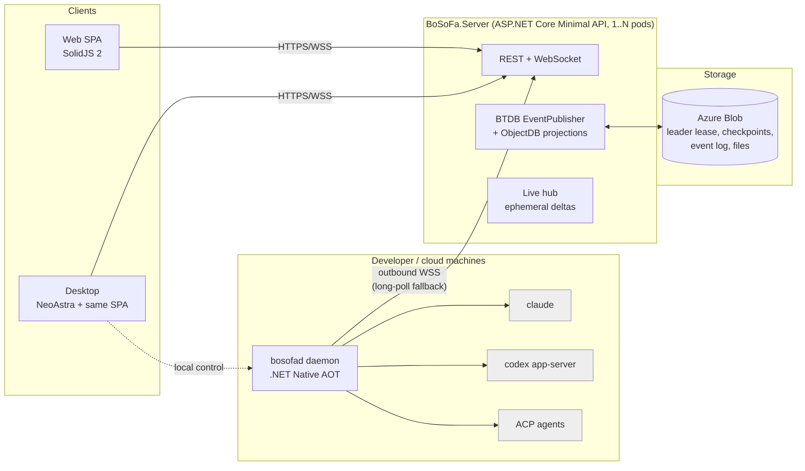

# BoSoFa: Bobris Software Factory, architecture and delivery plan

Status: draft 1 (2026-11-07). The decisions listed below are settled. The open questions are at the end.

## 1. What we are building

BoSoFa runs AI coding harnesses such as Claude Code, Codex, and ACP agents (Gemini CLI, Copilot CLI, OpenCode, …) on many machines. People control it from one place: a web UI or a desktop app.



### Settled decisions

| Area | Decision |
|---|---|
| Tenancy | One tenant with many users. User names and emails are visible to every user. |
| Server | C# / .NET 10 Minimal API (`WebApplication.CreateSlimBuilder`). AOT is not a goal, but stay AOT-friendly: the BTDB source generator, STJ source generation, no reflection in our code. Then publishing AOT later is a build switch, not a rewrite. |
| DB and event log | BTDB.Replication with EventSourcing: one process with file-system storages for development, Azure Blob storages with N pods (StatefulSet) on AKS. |
| Web UI | A pure SPA (no SSR, no SolidStart) in SolidJS 2, served as static files by the server with an `index.html` fallback. |
| Daemon | `bosofad`, C# .NET Native AOT. It talks to the server only over HTTP(S), always dialing out. |
| Daemon transport | A WebSocket over 443, falling back to HTTP long-poll plus batched POST. |
| Sign-in | Any OIDC provider. Development has a fake local login. |
| Desktop | NeoAstra (the CodeAlta UI technology) hosting the same SolidJS SPA. It is a client of the server and can also manage the local daemon. |

## 2. Lessons taken from the reference projects

From **CodeAlta** (local copy `../CodeAlta`):
- Pin each harness CLI version with a SHA-256 per platform. Give each harness and account its own home folder (`CLAUDE_CONFIG_DIR`, `CODEX_HOME`) and never touch the user's `~/.claude` / `~/.codex`.
- Drive Claude Code with `claude -p --input-format stream-json --output-format stream-json` and its control protocol. Drive Codex with `codex app-server` (JSON-RPC over stdio). Drive the long tail of agents through ACP.
- Use a loopback MCP endpoint per session, protected by a bearer token, to give harnesses our own tools.
- Workers dial out. Use idempotency keys and per-stream cursors, so that reconnecting resumes where it stopped and never duplicates.
- Self-update with a launcher parent, versioned folders side by side, a trial period, and automatic rollback.
- Use guardrail tests to enforce project boundaries, for example that the daemon never references server assemblies.
- NeoAstra: native web view (WebView2 / WKWebView / WebKitGTK), the `app://` scheme, a typed C#↔TS RPC that generates TypeScript, and a framework-agnostic Vite frontend.
- To avoid: a fleet surface that grew enormous (signed policies, campaigns, budgets…), and docs that drifted away from the code.

From **T3 Code** (`pingdotgg/t3code`):
- Our app's IDs are primary and provider IDs are only references. The model is Thread/Session → Run (turn) → tree of nodes (tool, approval, subagent).
- A provider adapter has explicit **capability flags** (steer, fork, rollback, compact…). Never branch on the provider's name.
- Approvals and questions are durable "runtime requests". They survive restarts and can be answered from any client.
- Clients subscribe to a cheap **shell/sidebar summary**, plus the full stream only for the session they are viewing (snapshot + cursor, then deltas).
- Message dispatch modes: *steer active*, *queue after active*, *restart active* (when the provider cannot steer).
- Checkpoints are git snapshots in hidden refs (`refs/bosofa/checkpoints/...`), so diffs and rollback never commit to the user's branch.
- Terminals are attach/observe: the PTY lives on the machine, keeps a capped history, and many clients can watch.
- Recorded replay fixtures per provider make tests deterministic and free.

## 3. Repository layout

```
bosofa/
  BoSoFa.slnx
  global.json  Directory.Build.props  Directory.Packages.props   (central package versions)
  AGENTS.md / CLAUDE.md          (agent rules, including the Solid 2 rules in §7)
  src/
    BoSoFa.Protocol/             AOT-safe: daemon↔server envelopes, DTOs, STJ source-gen context. No other deps.
    BoSoFa.Harness.Abstractions/ AOT-safe: normalized harness events, capability flags.
    BoSoFa.Server/               Minimal API host: auth, REST, WebSockets, static SPA, live hub.
    BoSoFa.Server.Domain/        BTDB events, handlers (Validate/Consume), relations, queries.
    BoSoFa.Server.Storage/       Blob store abstraction (Azure Blob / file system), content addressed.
    BoSoFa.Daemon/               bosofad executable (AOT): host, CLI, service install, launcher, updater.
    BoSoFa.Daemon.Core/          Connection, outbox, sessions, files, MCP endpoint, skills sync.
    BoSoFa.Daemon.Harnesses/     Adapters: ClaudeCode, Codex (app-server), Acp; installers.
    BoSoFa.Desktop/              NeoAstra host and native RPC services (local daemon, notifications, files).
  web/                           pnpm workspace
    packages/api/                Generated TS types and client (from OpenAPI + live message schema).
    packages/client/             Connection, normalized stores, subscriptions (shared by web and desktop).
    packages/ui/                 Solid components and headless primitives, theme tokens.
    apps/web/                    SPA entry (browser platform).
    apps/desktop/                SPA entry (NeoAstra platform: adds the local-daemon features).
  tests/                         MSTest/xUnit per project; Server.MultiNode tests on Azurite; Playwright e2e.
  deploy/                        Dockerfile, Helm chart (AKS), docker-compose (3 nodes + Azurite).
  docs/
```

Boundary rules, enforced by an architecture test:
- `Protocol` and `Harness.Abstractions` reference nothing of ours.
- The daemon never references `Server.*`.
- The server never references `Daemon.*` or `Harness` adapters.

## 4. Server

### 4.1 Hosting and BTDB

- The same binary runs in two modes:
  - **Single node (dev):** `AddBTDBReplicationSingleNode` + `AddBTDBEventLogSingleNode` with the `FileSystem*` storages under `./data`. No peer endpoints.
  - **Cluster (AKS):** `AddBTDBReplication` + `AddBTDBEventLog` with `AzureLeaderStorage`, `AzureReplicationStorage` and `AzureEventLogStorage`, plus `MapBTDBReplication()` / `MapBTDBEventLog()`. Map these on a **separate internal port** with `RequireHost`, so ingress never exposes them.
- Run as a StatefulSet with a headless Service (`publishNotReadyAddresses: true`) for stable peer DNS. Blob is the source of truth and `/data` is a cache (`emptyDir`, or a small PVC for warm restarts). Use workload identity for Blob.
- Domain state lives in **one `EventPublisher`** (a data topic plus a metadata topic). Handlers are `IEventHandler<TEvent[,TResult]>` with a synchronous `Validate` and a deterministic `Consume` that writes relations via `Ambient.Relation<T>()`, using `ev.When` and never the clock.
- Commands go through `PublishAndWaitAsync`, which gives read-your-writes on the pod that publishes. Any pod may publish, because the event log forwards to the topic owner, so writes never need routing to a leader.
- Leader-only background work runs in `ReplicationLeadership.RunWhileLeaderAsync`: timeouts, cleanup, the rollout scheduler, cloud-machine reaping.
- BTDB prerequisites, released in **BTDB 36.2.0** (pin all `BTDB*` packages to this version in `Directory.Packages.props`):
  - `ReplicationFileSet.RestoreAsync(local, storage, genesis)` restores published history or creates an empty database (check `HasPublishedHistory`); no test-only helper is needed.
  - `EventLogOptions.Retention = topic => …` gives per-topic `EventLogRetention(MaxBytes, MaxAge)`; null means forever. Keep the `EventPublisher` data and metadata topics forever.

### 4.2 What goes where

| Data | Store | Why |
|---|---|---|
| Users, machines, projects, sessions (summary), runs, runtime requests, harness/MCP/skill catalogs, enrollments, daemon releases, audit | Domain events → ObjectDB relations | Durable, queryable, replicated |
| Session transcript **items** (user message, final assistant message, tool call + result, plan, diff summary) | Domain events → `SessionItem` relation keyed `(SessionId, Seq)` | Durable history; any pod can query a page |
| Large payloads (tool output > 16 KiB, attachments, uploaded/downloaded files, skill bundles, daemon binaries, checkpoint diffs) | Blob store, content-addressed by SHA-256; events carry only the hash | Keeps the event log small |
| Streaming deltas (tokens, command output chunks, terminal bytes) | **Ephemeral** live hub, never persisted | Volume; the final item is persisted anyway |

- Delivering **live events to clients:** `Ambient.RegisterPostCommit` runs on every pod after each batch becomes visible. It pushes to the pod-local hub, and the hub fans out to the WebSocket subscribers on that pod. Clients carry the event-ID cursor (offset + 1) and resync with *snapshot + cursor* on reconnect, because post-commit callbacks are lost on a crash.
- **Ephemeral deltas across pods:** the pod holding the daemon's connection owns that machine's live streams. Its ID is recorded in a presence relation, refreshed by heartbeat events at a low rate, or via `ReplicationPresence`. Another pod whose client watches the session opens one internal streaming HTTP request to the owner pod: `GET /internal/live/machines/{id}` on the peer port. In single-node mode this is just an in-process call.
- **Commands from server to daemon** are durable. `MachineCommandIssued` creates a row in the `MachineInbox` relation. The owner pod's post-commit hook sends it immediately. On reconnect, the daemon receives every inbox row after its acknowledged cursor. `MachineCommandAcked` / `…Completed` close it.

### 4.3 API surface (v1)

- `GET /` and `/*`: the SPA (hashed assets cached forever, `index.html` no-cache).
- Auth:
  - `/auth/login`, `/auth/callback`, `/auth/logout`: the server is the OIDC confidential client (BFF pattern). The SPA gets an HttpOnly, SameSite=strict cookie and never holds tokens.
  - `/auth/desktop/start` → system browser → loopback redirect (RFC 8252) → one-time code → BoSoFa access and refresh tokens for the desktop app.
- REST `/api/v1/...`: users, machines, enrollments, projects, sessions, runs, runtime-requests (answer), harnesses, mcp-servers, skills, profiles, files, daemon-releases, settings. Each mutation is a command that returns `{ eventId }`, which serves as the client's cursor.
- WebSocket `/api/v1/live` for UI clients: messages `subscribe{shell}`, `subscribe{session,id,afterSeq}`, `subscribe{terminal,id}`, `unsubscribe`, `terminal.input`, `ping`. The server sends `snapshot`, `event`, `delta`, `resync`.
- Daemon endpoints `/api/daemon/v1/...` are described in §5.3.
- Contracts:
  - Write C# DTOs once, with `[JsonPolymorphic]` for unions.
  - Expose them through `Microsoft.AspNetCore.OpenApi`, including the live and daemon message schemas as components.
  - Generate the TypeScript with `openapi-typescript` into `web/packages/api`.
  - CI fails when the generated output is stale.

### 4.4 Auth and access model

- Users come from OIDC (`sub` + issuer). The first user becomes admin. Roles: `admin` and `member`.
- Data Protection keys are stored in Blob and protected with Key Vault, shared by all pods.
- The server's own token signing keys are kept the same way.
- Every member can see sessions, transcripts and the machine list: it is a team factory.
- **Controlling** a machine (starting sessions, files, terminals, answering approvals) needs the owner or an explicit grant: a user, `everyone`, or the per-machine flag `shared`.
- Admins manage catalogs, rollouts and cloud machines.
- API tokens let users script the API. They are hashed in the DB and scoped.
- Audit: each command event already records its actor. An `AuditEntry` relation projects them for the UI.

## 5. Daemon (`bosofad`)

### 5.1 Process and packaging

- Single-file Native AOT for `win-x64`, `win-arm64`, `osx-arm64`, `osx-x64`, `linux-x64`, `linux-arm64`, with `InvariantGlobalization` and source-generated STJ throughout. CI fails on any trimming or AOT warning.
- One binary is also the CLI:

```
bosofad enroll <server-url>      # device-code flow: prints a code, the user approves in the web UI
bosofad enroll <url> --token T   # join token (cloud and CI machines)
bosofad run                      # foreground
bosofad service install [--user|--system] | uninstall | start | stop | status
bosofad status | logs | doctor
bosofad update [--check]         # also triggered remotely by the server
```

- Local MCP and HTTP endpoints use Kestrel via `CreateSlimBuilder`, which is AOT-compatible, bound to loopback only.
- Data folder:
  - Windows: `%ProgramData%\BoSoFa` (system) or `%LocalAppData%\BoSoFa` (user).
  - macOS: `~/Library/Application Support/BoSoFa`.
  - Linux: `$XDG_DATA_HOME/bosofa` or `/var/lib/bosofa`.

### 5.2 Identity

- At enrollment the daemon generates an ECDSA P-256 key, protected by DPAPI on Windows and by mode 0600 on macOS/Linux. Its public key is registered on the server as a `Machine`.
- Authentication is challenge, then signature, then a short-lived (15 min) access token, sent as a bearer on the WebSocket and HTTP calls. This is simpler than signing every request and still never stores a long-lived secret on the server side.

### 5.3 Transport and buffering

- Primary: one `wss://server/api/daemon/v1/connect`. Fallback, automatically after repeated upgrade failures or when configured: `GET /api/daemon/v1/inbox?after=<cursor>` (long-poll for 25 s) plus `POST /api/daemon/v1/outbox` (batches).
- The envelope is the same on both transports:
  `{ "t": "kind", "id": "uuid", "stream": "session:<id>|machine", "seq": 123, "ack": 456, "p": {…} }`
- **Daemon → server durable messages** (session items, run state, runtime requests, command results, inventory):
  - They go to a local **outbox**: append-only segment files with a fixed record framing and an fsync policy (batch every 50 ms).
  - Each stream has a monotonic `seq`. The server dedups on `(machine, stream, seq)` using the last applied seq stored in a relation, and acks the highest contiguous seq. Acked segments are deleted.
  - When the server is unreachable the daemon keeps working and the outbox grows (configurable cap, 1 GiB default; past the cap it drops the oldest *ephemeral-only* data and never items).
- **Ephemeral deltas** go only when connected and are dropped otherwise. The UI then shows the final item when it arrives.
- **Server → daemon commands** come from the durable `MachineInbox`, using an `after` cursor and idempotent handling. The daemon keeps applied command IDs for 7 days.
- Large uploads (files, big tool outputs) go out of band. The daemon calls `PUT /api/daemon/v1/blobs/{sha256}` in 8 MiB chunks, resumable, skipped when the server already has the hash. The message then carries only the hash.

### 5.4 Harnesses

- `IHarnessAdapter` (in `Harness.Abstractions`):

```csharp
interface IHarnessAdapter {
  HarnessCapabilities Capabilities { get; }   // Steer, Queue, Fork, Rollback, Compact, Resume, PlanMode, Subagents, McpInjection...
  Task<HarnessSession> StartAsync(StartSessionSpec spec, CancellationToken ct);
  Task ResumeAsync(...); Task SendAsync(UserMessage msg, DispatchMode mode, ...);
  Task InterruptAsync(...); Task RespondAsync(RuntimeRequestId id, RuntimeResponse r, ...);
  IAsyncEnumerable<HarnessEvent> Events { get; } // normalized: RunStarted, ItemStarted/Delta/Completed, RuntimeRequest, PlanUpdated, Usage, RunEnded(status, disposition)
}
```

- The adapters:

| Harness | Protocol | Notes |
|---|---|---|
| Claude Code | `claude -p --input-format stream-json --output-format stream-json` plus the control protocol (permission prompts via stdio) | Uses `CLAUDE_CONFIG_DIR` per account profile and `--mcp-config` for injected MCP. The Agent SDK is TS/Python only, so we speak the CLI protocol directly, as CodeAlta does. |
| Codex | `codex app-server` over stdio JSON-RPC: `thread/*`, `turn/start|steer|interrupt`, approval requests | Uses its own `CODEX_HOME` with a generated `config.toml`. Types are generated from the app-server schema. |
| ACP (Gemini CLI, Copilot CLI, OpenCode, Cursor…) | ACP JSON-RPC over stdio | Types are generated from the ACP schema. Per-agent oddities go in quirk classes. |

- **Install and update:**
  - The server holds a `HarnessRelease` catalog: id, version, and per-RID artifacts `{url, sha256, kind: archive|binary|npm}`.
  - The daemon installs into `harnesses/<id>/<version>/` and keeps the previous version for rollback.
  - npm-only agents get a daemon-managed portable Node runtime, itself a catalog entry.
  - Machines report their inventory. Admins pin versions per channel.
- **Credentials:**
  - Either the user signs in to the harness once on the machine (through a BoSoFa terminal, inside the profile's config folder),
  - or an admin attaches an API-key secret to a profile. Secrets are encrypted to the machine's public key (ECIES), so the server stores only ciphertext per machine.
- **Workspaces:**
  - A project is a repo URL. A workspace is `(machine, path)`.
  - A session can run in place or in a new worktree on a `bosofa/<slug>` branch.
  - Git is driven through the `git` CLI.
  - Checkpoints go into hidden refs, and diffs are computed from checkpoints.
- **Replay adapter:** it plays recorded JSONL fixtures and is used by all server and UI tests.

### 5.5 MCP and skills

- **The BoSoFa MCP endpoint:**
  - One per session at `http://127.0.0.1:<port>/mcp/<session>` (Streamable HTTP, per-session bearer), using the official `ModelContextProtocol` C# SDK, AOT-checked.
  - Tools: `bosofa_notify_user`, `bosofa_ask_user`, `bosofa_upload_file`, `bosofa_session_*` (start or ask another session; later: on another machine).
  - Every harness gets it injected automatically.
- **Managed MCP servers:**
  - A server catalog holds definitions (stdio command + args + env secret references, or a remote URL + auth).
  - Profiles bundle `harness + model + MCP servers + skills + approval mode`.
  - The daemon writes each harness's native config (`--mcp-config` JSON, the `config.toml` `[mcp_servers]` section, ACP `session/new.mcpServers`). It never edits user-owned files.
- **Skills:**
  - Versioned bundles (a zipped `SKILL.md` folder, content-hashed) live in the blob store.
  - The daemon syncs the bundles a profile needs and places them in the harness's skill folder (`$CLAUDE_CONFIG_DIR/skills`, `$CODEX_HOME/skills`, `.agents/skills`).
  - Each session's skills are snapshotted at its start.

### 5.6 Files

- **Download** (server → disk) is a command `{blobHash, targetPath, mode}`. **Upload** (disk → server) is a command `{path|glob}` and returns blob hashes.
- Allowed roots are the registered workspaces plus explicitly configured folders. Path traversal is rejected, and so are symlinks that escape the roots.
- A file browser API (list, stat, read a text range) backs the UI. It sits under the same roots and requires machine-control rights.

### 5.7 Service install and self-update

- **Service install:**
  - Linux: a systemd unit, `--user` (with `loginctl enable-linger`) or system with `User=`.
  - macOS: a LaunchAgent (`--user`) or a LaunchDaemon with `UserName`.
  - Windows: a real Windows Service via `Microsoft.Extensions.Hosting.WindowsServices`, running as LocalSystem or a given account, for cloud and build machines. Dev machines use a per-user logon task.
  - The service runs as a user because harness credentials and git credentials live in that user's profile. `doctor` explains this.
- **Self-update:**
  - The service always runs the stable **launcher** path, `bosofad` in the data folder. The launcher starts `versions/<v>/bosofad` as a child.
  - The child exits with code 75 to mean "switch version".
  - A new version is on trial and must reach the server and confirm within 2 minutes, or the launcher rolls back.
  - The service definition is never rewritten.
- **Releases:**
  - CI publishes per-RID binaries to the server: `POST /api/v1/daemon-releases`, artifacts go to the blob store.
  - Each manifest is signed with an offline release key (ECDSA P-256), and its public key is compiled into the daemon. The daemon refuses unsigned or mismatching manifests.
  - Channels are `stable` and `beta`, with a per-machine pin. The leader rolls out in waves.

### 5.8 Ad-hoc cloud machines (later phase)

- Same daemon and protocol. They are machines with `kind=ephemeral`, created through a provisioner interface (AKS Job/Pod with a dev image, Azure Container Apps job, VM scale set). Each gets a one-time join token in its environment.
- A session can request "any machine with labels X". The leader schedules it and reaps idle ephemeral machines.

## 6. Desktop

- **BoSoFa.Desktop:**
  - .NET 10 plus **NeoAstra**: framework-dependent with ReadyToRun (not AOT, like CodeAlta), and no native title bar.
  - It hosts `web/apps/desktop`, which is the SPA plus a desktop platform module.
  - Distribution: `dotnet tool install -g BoSoFa.Desktop` (like CodeAlta), later signed installers.
- **Talking to the server:** the WebView calls the server directly (CORS plus a bearer from the desktop token flow), with `connect-src` including the server origin. Alternative: tunnel through C# RPC. Decide in the M0 spike.
- **Native RPC services** (`[NeoRpcService]`):
  - `LocalDaemon`: detect, install as service, enroll this machine, start/stop, tail logs. It talks to the daemon over a local control socket (a named pipe or Unix socket), never over the network.
  - Also: OS notifications, open in editor/Finder, file pickers, deep links (`bosofa://`), the OS keychain for the refresh token.
- **Platform abstraction in the UI:** `web/packages/client` defines a `Platform` interface. `apps/web` implements the browser version and `apps/desktop` the NeoAstra version. Features that need a local daemon are hidden on the web.

## 7. Web UI (SolidJS 2, pure SPA)

- **Versions:** Solid 2 is a **release candidate**. Pin exact versions and upgrade them together on purpose:
  - `solid-js@2.0.0-rc.21`
  - `@solidjs/web@2.0.0-rc.21`
  - `@solidjs/router@2.0.0-next.44`
  - `@solidjs/vite-plugin@3.0.0-next.57` (Vite 8; no `start` mode, since it is a pure SPA)
  - `@solidjs/diagnostics`
  - `eslint-plugin-solid` with `configs/v2-strict`
- **Router:** `@solidjs/router@next` with path history. The server and NeoAstra both use an `index.html` fallback.
- **UI kit:** no component library supports 2.0 yet. Build our own small headless set in `packages/ui` (dialog, popover, menu, tabs, combobox, toast, tooltip, splitter, virtual list) with Tailwind 4 and theme CSS variables (light/dark). In M0, spend one week trying the `@kobalte/core@2.0.0-alpha` line as an alternative.
- **Heavy widgets**, all framework-agnostic and wrapped once:
  - xterm.js (terminals)
  - CodeMirror 6 or Monaco for the composer, file viewer and diff (decide in M0; CodeMirror is lighter)
  - markdown-it + DOMPurify + Shiki
- **State:**
  - `packages/client` holds the WebSocket connection with cursor resync.
  - Normalized stores per subscription: the shell summary is always on, and a session's full stream is on only while visible.
  - Mutations are `action(function*…)` with `createOptimisticStore`.
- **Screens:** sessions board/sidebar, session view (transcript, composer with steer/queue, approvals inline, plan, diff, files changed), machines (status, inventory, harnesses, terminals), projects/workspaces, catalogs (harnesses, MCP, skills, profiles), people, settings and rollouts, audit.
- **Rules for agents** (go into `AGENTS.md`):
  - Solid 2 docs: `https://v2.solidjs.com/llms-small.txt` (the primer), `/llms.txt`, and `/llms-full.txt`.
  - Read `node_modules/solid-js/CHEATSHEET.md`, `solid-js/skills/solid-2.0/SKILL.md` and `@solidjs/diagnostics/skills/agent-loops/SKILL.md`.
  - Never write Solid 1.x APIs: use two-argument `createEffect`, `onSettled`, `<Loading>`/`<Errored>`, draft-style store setters, `merge`/`omit`, and `<Ctx value>`.
  - Never destructure props.
  - Every `[CODE]` diagnostic counts as a defect.

## 8. Domain model (first cut)

- **Relations:**
  - `User`, `ApiToken`
  - `Machine` (owner, kind, os/arch, labels, daemonVersion, publicKey, grants), `Enrollment`, `MachinePresence`
  - `Project`, `Workspace(machine, path, project)`
  - `HarnessDefinition`, `HarnessRelease`, `MachineHarness`
  - `McpServerDefinition`, `SkillBundle(version, hash)`, `Profile`, `Secret(per machine ciphertext)`
  - `Session(project, workspace, machine, harness, profile, creator, status, branch, parent, title, usage)`, `Run(session, ordinal, status, checkpointBefore/After)`, `SessionItem(session, seq, kind, payload|blobHash)`, `RuntimeRequest(run, kind, payload, status, answeredBy)`
  - `MachineInbox(machine, cmdId, kind, payload, status)`, `StreamCursor(machine, stream, lastSeq)`
  - `FileTransfer`, `DaemonRelease`, `RolloutPolicy`, `AuditEntry`
- **Example events:**
  - `UserSignedIn`, `MachineEnrolled`, `MachineHeartbeat` (coarse, at most one per minute)
  - `SessionCreated`, `RunStarted`, `SessionItemsAppended` (batched), `RuntimeRequestRaised` / `Answered`, `RunEnded`
  - `MachineCommandIssued` / `Acked` / `Completed`
  - `HarnessReleasePublished`, `DaemonReleasePublished`, `ProfileChanged`
- **Schema evolution:** changes to persisted relations require a new `ApplicationGeneration` and a prepared-upgrade handoff. Event payloads evolve through the metadata topic. Prefer additive changes and keep a changelog of persisted shapes.

## 9. Delivery plan

| Milestone | Scope | Done when |
|---|---|---|
| **M0 Foundations and spikes** (2 wk) | Repo skeleton, CI (build, AOT-warning gate, contract-staleness check), single-node server with BTDB genesis, dev login, SPA shell served. Spikes: ① BTDB event volume (1M `SessionItemsAppended`, latency, disk/Blob growth), ② Solid 2 UI kit choice, ③ NeoAstra hello with the Solid SPA and remote `connect-src`, ④ Claude stream-json + control protocol from an AOT C# process. | The UI shows "hello <user>" from a BTDB-backed endpoint. Spike notes are written in `docs/spikes/`. |
| **M1 First session end to end** | Daemon: enroll (device code), WebSocket, outbox, ClaudeCode adapter in place (no worktree), runtime requests. Server: sessions, items, live hub, inbox. UI: machines list, session view, composer, approvals. Replay adapter + fixtures. | Start Claude Code on my laptop from the browser, approve a tool, see the streamed answer, kill the server mid-run, and see the session catch up. |
| **M2 Multi-node early** | docker-compose with 3 nodes + Azurite, Azure storages, internal live relay, peer port, presence ownership, failover test in CI. | The M1 scenario passes while the leader pod is killed. |
| **M3 More harnesses and git** | Codex app-server and ACP adapters, the harness install/update catalog with pinned hashes, worktrees, checkpoints, diffs, steer/queue/interrupt. | The same project runs on Claude, Codex and Gemini with diffs per run. |
| **M4 MCP, skills, files, terminals** | BoSoFa MCP endpoint, managed MCP catalog + profiles, skill bundles, file upload/download + browser, attach/observe PTY terminals. | A profile pushes a new skill and an MCP server to a machine and a session uses them. |
| **M5 Operations** | Service install on all 3 OSes, launcher + signed self-update + rollout channels, long-poll fallback, API tokens, audit UI. | Install on Windows/macOS/Linux, roll out a new daemon version remotely, roll back a broken one automatically. |
| **M6 Desktop** | NeoAstra app, desktop auth flow, LocalDaemon RPC (install/enroll this machine), notifications, deep links. | Fresh machine: install the desktop, click "enable this machine", and run a session. |
| **M7 AKS production** | Helm chart, workload identity, Key Vault Data Protection, private-CA TLS for peers, ingress tuning (no buffering, WebSocket idle timeouts), OpenTelemetry, backups. | Staging cluster, 3 replicas, a rolling upgrade with an `ApplicationGeneration` bump. |
| **M8 Cloud machines** | Provisioner interface + one implementation, ephemeral machines, label scheduling. | "Run on any linux machine" starts a pod and cleans up after it. |

### M0 outcomes (2026-11-08)

M0 is done: the server shows "Hello <user>" from the BTDB-backed `/api/v1/me`, and the daemon publishes with Native AOT. The experiment notes are in `docs/spikes/`. The plan changes they lead to:

- **① BTDB volume** ([01](spikes/01-btdb-event-volume.md)):
  - Single-node on file storage manages only about 83 events/s, because `FileSystemEventLogStorage` completes synchronously and so defeats commit batching. Fix this in BTDB (offloading restores 2.4k/s with 32 publishers and 11.8k/s with 256).
  - Batch up to about 64 items or 128 KiB per `SessionItemsAppended`.
  - The inline-payload limit in §4.2 drops from 64 KiB to **16 KiB**. Larger payloads go to blobs.
  - Disk use is about 3× the payload. A warm restart is ready in under 1 s.
- **② UI kit** ([02](spikes/02-solid-ui-kit.md)):
  - Build our own headless primitives in `packages/ui` from the spike code (dialog, popover, menu, tooltip first).
  - Keep the API shaped like Kobalte's, and revisit Kobalte once Solid 2 is stable and it runs without diagnostics.
  - Check CSS anchor positioning on WebKit and Firefox; `@floating-ui/dom` is the fallback.
- **③ Desktop** ([03](spikes/03-neoastra-desktop.md)):
  - NeoAstra 1.12.0 runs the unchanged SPA.
  - Cookies never work from `app://`, so the desktop uses **CORS plus short-lived bearer tokens**. C# keeps the refresh token in the OS keychain, and the WebSocket connects with a one-time ticket.
  - Server work, due by M6: CORS for the desktop origin, a token endpoint and WebSocket tickets.
- **④ Claude Code** ([04](spikes/04-claude-stream-json.md)):
  - The stream-json protocol and the control protocol work from an AOT process: permissions, partial text, resume, interrupt and in-process MCP.
  - The adapter must always pass `--permission-mode` and start `claude` from a clean environment.

## 10. Risks

| Risk | Mitigation |
|---|---|
| Event log growth | Keep deltas out of the log, put large payloads in blobs, measure in spike ①. Use the new per-topic retention (size/age) wherever history is also kept elsewhere; the data and metadata topics of the event-sourced DB stay forever. |
| BTDB.Replication is not yet production-qualified (open B3/E7 items) | Multi-node failover in CI from M2. Its owner is the same person as ours. |
| Solid 2 is a release candidate, and there is no component library | Exact pins, our own headless primitives, diagnostics and the strict lint in CI. |
| NeoAstra is maintained by one author | The UI is a plain SPA, so the desktop shell can be swapped (Photino, Tauri, Electron) without a rewrite. |
| Harness CLIs change their protocols often | Pinned versions + hashes, schema-generated types for Codex/ACP, replay fixtures, a version gate in the catalog. |
| Windows service versus user credentials | A per-user mode by default on dev machines, a service account on cloud machines, and `doctor` checks. |
| Cross-pod fan-out of ephemeral deltas | Owner-pod streaming with a fallback: the UI tolerates gaps because it resyncs to persisted items. |

## 11. Open questions

1. Hosting the server: AKS only, or also a plain VM or container with single-node file storage for small installs? File storages are single-process, so that would be a "one pod forever" mode.
2. Should session transcripts be visible to every member, or only to the creator + machine owner + people explicitly shared?
3. Who may enroll a machine? Any member (it becomes their own machine), or admins only?
4. Harness credentials: per-user subscriptions signed in on each machine, team API keys pushed as secrets, or both?
5. Does the desktop need to show the local daemon's sessions while the server is unreachable (read-only from the outbox), or is "server required" acceptable?
6. Do we need a git forge integration (PR per session, auto-settle on merge) in v1, and for which forge (GitHub, Azure DevOps)?
7. Names: `bosofad` for the daemon binary and `BoSoFa.*` for the projects. Keep them?
